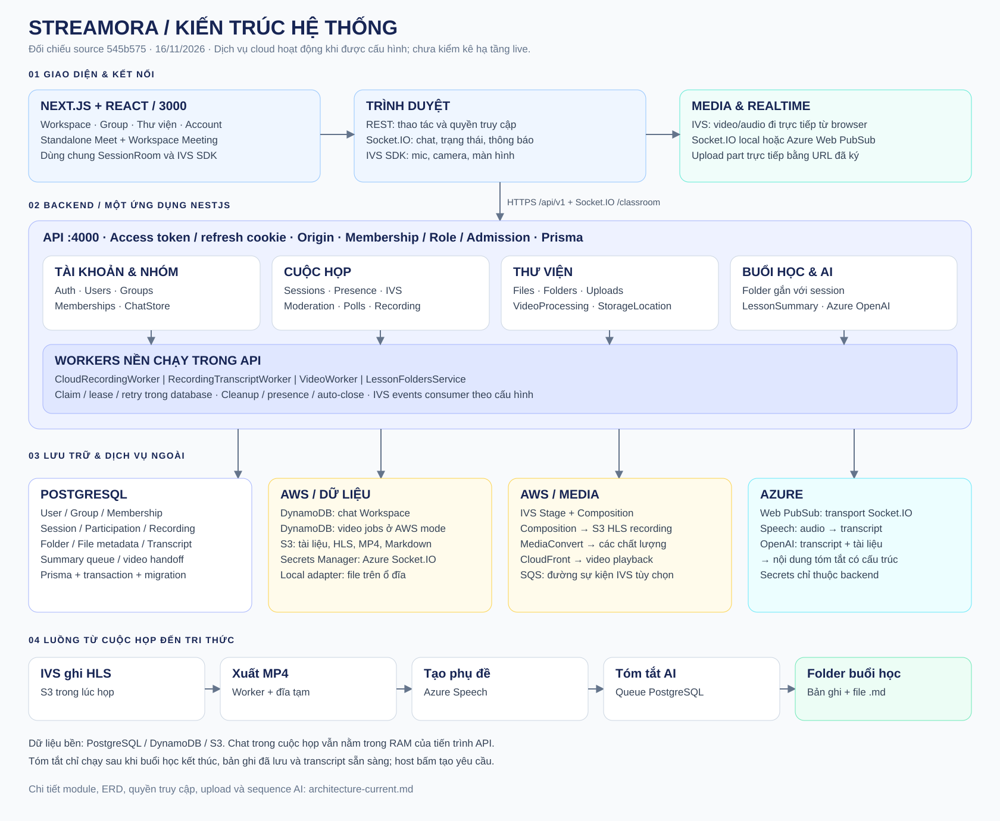
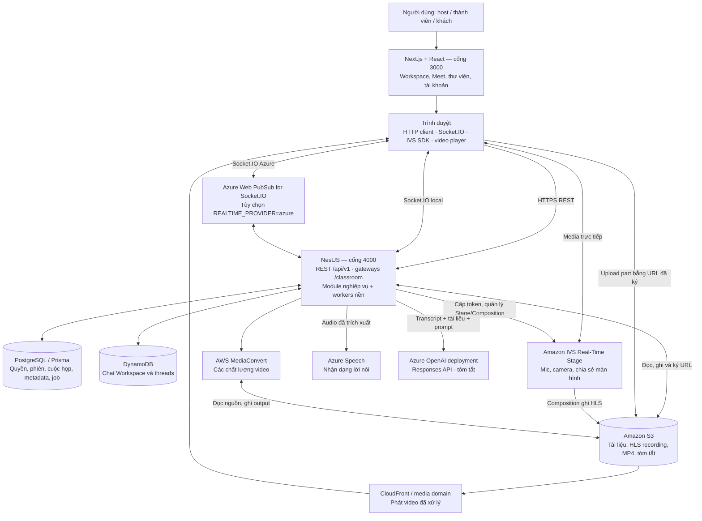
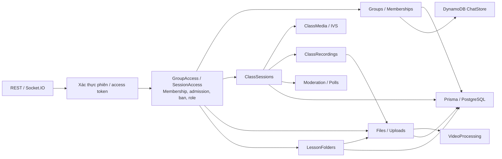
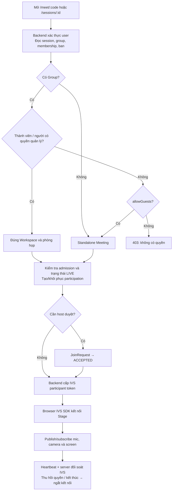
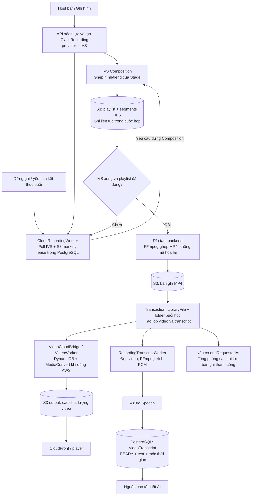
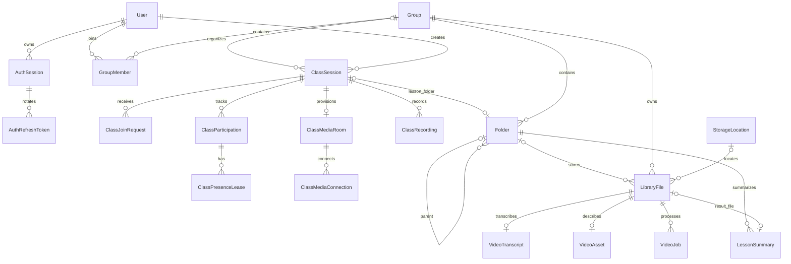

# Kiến trúc Streamora — code hiện tại

Đối chiếu ngày 16/11/2026, commit `545b575` (`fix: continuous streamming`). Đây là kiến trúc được xác nhận từ repository; chưa kiểm kê tài nguyên đang chạy trong tài khoản AWS/Azure. Dịch vụ cloud phụ thuộc cấu hình môi trường. Các sơ đồ dùng Mermaid để có thể chỉnh sửa và xuất lại.



## 1. Các tầng của hệ thống

Streamora là monorepo npm workspaces. Backend là một ứng dụng NestJS chia module; nhiều worker được chạy ngay trong tiến trình API. Frontend Next.js phục vụ cả Workspace và Meeting độc lập, dùng chung logic phòng họp.



**Ba luồng mạng độc lập:** REST quản lý quyền/trạng thái; Socket.IO truyền sự kiện/chat; IVS truyền hình/tiếng. Azure Web PubSub không vận chuyển video/audio cuộc họp. Video không đi qua HTTP NestJS để chuyển tiếp giữa người tham gia.

## 2. Frontend và module backend

| Thành phần | Trách nhiệm | Code chính |
|---|---|---|
| `frontend` | Next.js App Router, React, giao diện tiếng Việt, theme, Workspace và Meet | `frontend/src/app`, `frontend/src/components/workspace.tsx` |
| Auth client | Access token trong bộ nhớ, refresh qua cookie; đồng bộ phiên | `frontend/src/lib/auth/session.ts` |
| Meeting client | Điều khiển phòng, IVS Stage, mic/camera/screen, trạng thái recording | `frontend/src/lib/class-sessions` |
| Upload client | Chia part, pause/resume, lưu trạng thái/nguồn phục hồi bằng IndexedDB | `frontend/src/lib/files/upload-store.ts` |
| `@streamora/contracts` | DTO/types và chính sách dùng chung giữa frontend/backend | `backend/contracts/src` |
| Auth + Users | Đăng nhập, refresh rotation, thu hồi phiên, cập nhật hồ sơ | `backend/src/modules/auth`, `users` |
| Groups + Memberships | Nhóm, vai trò, quyền, kênh, chat Workspace và threads | `groups`, `memberships` |
| ClassSessions | Tạo/lên lịch, link/mã họp, duyệt vào, participation, presence, tự kết thúc | `class-sessions` |
| ClassMedia | Stage/token IVS, các kết nối mic/camera/screen, đối soát trạng thái media | `class-media` |
| ClassModeration + Polls | Chặn/kick, khóa mic, giơ tay và bình chọn | `class-moderation`, `polls` |
| ClassRecordings | Bắt đầu/dừng Composition, thu HLS, xuất MP4, transcript | `class-recordings` |
| Files + Uploads | Metadata thư viện, cây folder, quyền công bố/tải, multipart và cleanup | `files`, `uploads` |
| VideoProcessing | Job video, FFmpeg hoặc MediaConvert, catalog và quyền phát | `video-processing` |
| LessonFolders | Folder gắn buổi học, nguồn tóm tắt, queue và Azure OpenAI | `lesson-folders` |
| Communities + Rooms | Các endpoint scaffold/demo còn trong ứng dụng | `communities`, `rooms` |



Các mũi tên ở sơ đồ module thể hiện phụ thuộc nghiệp vụ chính, không phải toàn bộ đồ thị import NestJS.

## 3. Tham gia cuộc họp và truyền media



Frontend dùng chung `SessionRoom` và các hook media cho hai chế độ giao diện. Group member vào Workspace kể cả khi Group cho phép khách. `allowGuests` chỉ mở khả năng xin vào cho người ngoài; backend vẫn xét quyền và admission. Code mới có `memberAdmission` để điều khiển cách thành viên vào phòng.

Backend lưu `ClassMediaRoom`, `ClassMediaConnection`, `ClassParticipation`, `ClassPresenceLease`; cờ kết nối do frontend gửi không phải bằng chứng duy nhất của việc còn ở phòng. Có đường consumer SQS cho sự kiện IVS khi bật cấu hình; luồng recording mới chủ động kiểm tra IVS/S3 và không cần đợi SQS để thu bản ghi.

## 4. Recording → video → phụ đề → tóm tắt



Đóng phòng không phải đợi các chất lượng video và phụ đề hoàn tất. Nếu lưu bản ghi thất bại, yêu cầu kết thúc chưa được hoàn tất tự động. HLS gốc vẫn ở S3 để xử lý/khôi phục theo luồng recording.

**Recording cũ:** `MediaRecorder` trong browser gom `Blob[]`, đến khi dừng mới upload. Code thu browser đó đã bị bỏ khỏi frontend hiện tại; các bản ghi cũ vẫn có thể đọc. **Recording mới:** IVS ghi S3; browser chỉ điều khiển. Backend vẫn cần RAM/CPU cho xử lý, và đĩa tạm cho xuất MP4/trích audio.

```mermaid
sequenceDiagram
  actor H as Host
  participant UI as Popup tóm tắt
  participant API as LessonFolders API
  participant DB as PostgreSQL
  participant W as Worker trong NestJS
  participant FS as S3 hoặc local storage
  participant AI as Azure OpenAI
  H->>UI: Nhập yêu cầu bổ sung, bấm Tạo tóm tắt
  UI->>API: POST /folders/:id/summary
  API->>DB: Kiểm tra quyền, ENDED, bản ghi đã lưu, transcript READY
  API->>DB: Chụp danh sách nguồn; hash; lưu job PENDING
  API-->>UI: 202 Accepted + trạng thái job
  Note over H,UI: Có thể đóng popup hoặc rời trang
  W->>DB: Poll mỗi 3 giây; claim job và lease 4 phút
  W->>DB: Kiểm tra lại quyền và nguồn
  W->>FS: Đọc PDF, ảnh, text
  W->>AI: Transcript + tài liệu + prompt cơ sở + yêu cầu host
  AI-->>W: JSON gồm title, markdown, sourceIds
  W->>DB: Kiểm tra lại nguồn/quyền và quyền sở hữu job
  W->>FS: Ghi file Markdown
  W->>DB: Lưu LibraryFile trong đúng folder + READY
  UI->>API: GET trạng thái mỗi 3 giây khi popup mở
  API-->>UI: Nội dung và file kết quả
```

Job AI lưu trong bảng `lesson_summaries`, không dùng SQS/Redis. Mỗi tiến trình API xử lý một job AI tại một thời điểm, có cơ chế claim để các tiến trình không cùng sở hữu một lượt xử lý. Lỗi tạm thời/429 thử tối đa 3 lần. Dữ liệu video được gửi dưới dạng transcript có mốc thời gian; không gửi nguyên MP4 cho model. Tài liệu hỗ trợ PDF, JPEG/PNG/WebP, text/Markdown/CSV/JSON. Giới hạn hiện tại: 50 nguồn, 18 MB tài liệu, 240.000 ký tự transcript. Phụ đề chưa xong thì yêu cầu tóm tắt bị chặn; chưa có queue tóm tắt tự chờ phụ đề xong rồi tiếp tục.

## 5. Upload và phát tài liệu/video

```mermaid
sequenceDiagram
  participant B as Trình duyệt
  participant A as API Uploads/Files
  participant P as PostgreSQL
  participant S as S3 hoặc PUT local 4002
  participant V as Video worker
  B->>A: Khởi tạo upload trong Group/folder
  A->>P: Kiểm tra quyền và tạo UploadSession
  A-->>B: Session + URL ký cho part
  loop Các part, có retry/pause/resume
    B->>S: PUT bytes trực tiếp
  end
  B->>A: Complete upload
  A->>S: Hoàn tất/xác minh object
  A->>P: File AVAILABLE; metadata và liên kết folder/session
  A->>V: Tạo công việc xử lý nếu là video
  B->>A: Yêu cầu xem/tải/phát
  A->>P: Kiểm tra membership, quyền và trạng thái công bố
  A-->>B: URL hoặc quyền phát ngắn hạn
  B->>S: Tải file gốc; video AWS phát qua CDN
```

`StorageLocation` lưu danh tính nơi lưu của từng file, tránh việc đổi bucket/driver làm file cũ bị trỏ sai nơi. PostgreSQL giữ metadata và job handoff; DynamoDB giữ trạng thái xử lý video chính khi dùng AWS. `VideoCloudBridge` nối hai hệ thống và đồng bộ trạng thái hoàn tất. Ở local, FFmpeg và PostgreSQL thay đường MediaConvert/DynamoDB video.

## 6. Dữ liệu và quan hệ chính



ERD lược bỏ nhiều trường và bảng phụ để dễ đọc. `ClassSession.groupId` rỗng biểu diễn cuộc họp độc lập. `Folder.sessionId` unique biểu diễn một folder buổi học cho một session; folder thường không có sessionId. `LibraryFile` giữ liên kết blob qua objectKey/storageLocationId.

| Nơi giữ dữ liệu | Nội dung chính | Có tồn tại sau restart? |
|---|---|---|
| PostgreSQL | User, auth session/refresh, Group/member, session/admission/presence, recording state, folder/file metadata, transcript, summary/job, poll | Có |
| DynamoDB chat | Tin nhắn Workspace, thread, trạng thái đọc/thay đổi theo ChatStore | Có |
| DynamoDB video, khi AWS mode | Job, trạng thái/lease xử lý và output video | Có |
| S3 | Tài liệu, HLS gốc recording, MP4, output video, file Markdown | Có |
| Local storage adapter | File và parts trên ổ đĩa backend khi dùng driver local | Có nếu giữ ổ đĩa |
| RAM tiến trình API | Chat cuộc họp `meetingMessages`, socket/client maps, một số bộ đếm rate limit | Không |
| Trình duyệt | Access token trong RAM; cookie refresh HttpOnly; IndexedDB phục hồi upload; theme và trạng thái UI | Tùy loại |

Schema vẫn có một số bảng chat PostgreSQL phục vụ đường cũ/thông báo/chuyển đổi. Không nên suy ra toàn bộ lịch sử chat Workspace hiện nằm trong PostgreSQL chỉ vì có model `GroupChatMessage`.

## 7. Runtime, hàng đợi và triển khai

| Công việc | Nơi giữ trạng thái | Nơi chạy |
|---|---|---|
| API + Socket.IO local | PostgreSQL, DynamoDB và trạng thái socket trong RAM | Tiến trình NestJS cổng 4000 |
| Azure Socket.IO | Azure quản lý kết nối, ứng dụng vẫn kiểm tra quyền | AzureIoAdapter trong NestJS; secret đọc từ AWS Secrets Manager |
| Recording cloud | `ClassRecording`, lease và trạng thái ở PostgreSQL; output S3 | `CloudRecordingWorker` trong API |
| Phụ đề | `VideoTranscript`, trạng thái/lượt thử/lease ở PostgreSQL | `RecordingTranscriptWorker` trong API; poll 5 giây |
| AI summary | `LessonSummary` ở PostgreSQL | `LessonFoldersService` trong API; poll 3 giây |
| Chuyển mã video | SQL ở local; DynamoDB chính khi AWS mode | `VideoWorker` trong API; FFmpeg/MediaConvert theo mode |
| IVS events | SQS và `IvsEvent` | Consumer theo `IVS_WORKER_ENABLED`, hoặc entry point `ivs-events.worker.ts` |
| Kết thúc/cleanup/presence | Event/lease/trạng thái database | Các service định kỳ trong API |

`backend/realtime/src/main.ts` trên cổng 4001 gọi lại **cùng `createApplication` của API**, không phải một service chat độc lập tối giản. Chạy thêm entry point này có thể tạo thêm các worker của ứng dụng tùy config.

Tài liệu deploy hiện ghi PM2 process `streamora` cho Next.js và `streamora-api` cho NestJS. API chạy `prisma migrate deploy` trước khi mở port và worker, trừ môi trường test. `npm run build` biên dịch code/generate Prisma; migration thuộc bước khởi động API. Không xác nhận số máy, load balancer, vùng cloud hay domain production từ source code.

## 8. Bảo mật và giới hạn cần biết

- REST dùng access token, refresh cookie HttpOnly và kiểm tra Origin; CORS cho đúng `WEB_ORIGIN`. POST auth từ origin khác bị từ chối.
- Backend kiểm tra Group Membership, vai trò, admission, ban và phiên hiện tại trước hành động. Link phòng/file không tự cấp quyền vượt qua các kiểm tra này.
- Socket.IO `/classroom` xác thực token; gateway kiểm tra lại quyền với các sự kiện và người nhận.
- Token IVS, URL upload/download và quyền phát được cấp bởi backend sau xác thực. Client không chứa AWS/Azure secret.
- Summary chỉ cho người có quyền quản lý yêu cầu; kiểm tra nguồn/quyền trước gửi AI và trước lưu. Đầu vào chưa công bố làm kết quả ở trạng thái chưa công bố.
- Chạy nhiều API cần cùng DB, secrets và transport realtime phù hợp. Azure Web PubSub không tự biến chat cuộc họp trong RAM thành dữ liệu bền hoặc lịch sử dùng chung; rate limit trong RAM cũng chưa thành quota toàn cluster.
- Trong code runtime đã đọc không thấy tích hợp Gemini/Google Cloud, Redis hay RabbitMQ cho luồng chính. Tài liệu `architecture-multicloud.md` và `infra/kubernetes/README.md` là phương án/khung cũ, không dùng để khẳng định hạ tầng đang hoạt động. Kubernetes chưa có bộ manifest production trong thư mục này.
- Một số màn hình demo/trình phát trực tiếp minh họa vẫn tồn tại; không đồng nhất chúng với đường IVS cuộc họp hoặc HLS bản ghi thực tế.

## 9. Điểm đối chiếu trong repository

- Bootstrap/module: [app.module.ts](../src/modules/app.module.ts), [app.ts](../src/app.ts), [main.ts](../src/main.ts), [deploy-migrations.ts](../src/database/deploy-migrations.ts).
- Truy cập phòng: [class-session-access.service.ts](../src/modules/class-sessions/class-session-access.service.ts), [class-sessions.gateway.ts](../src/modules/class-sessions/class-sessions.gateway.ts), [ivs.service.ts](../src/modules/class-media/ivs.service.ts).
- Chat/transport: [chat-store.ts](../src/modules/memberships/chat-store.ts), [membership.gateway.ts](../src/modules/memberships/membership.gateway.ts), [azure-io.adapter.ts](../src/realtime/azure-io.adapter.ts), [realtime entry point](../realtime/src/main.ts).
- Recording/Speech: [cloud-recording.worker.ts](../src/modules/class-recordings/cloud-recording.worker.ts), [recording-export.ts](../src/modules/class-recordings/recording-export.ts), [recording-transcript.worker.ts](../src/modules/class-recordings/recording-transcript.worker.ts), [azure-speech-transcriber.ts](../src/modules/class-recordings/azure-speech-transcriber.ts).
- Storage/video: [file-storage.service.ts](../src/modules/files/file-storage.service.ts), [video-processing-core.module.ts](../src/modules/video-processing/video-processing-core.module.ts), [video-cloud-bridge.ts](../src/modules/video-processing/video-cloud-bridge.ts), [video-delivery.ts](../src/modules/video-processing/video-delivery.ts).
- AI: [lesson-folders.service.ts](../src/modules/lesson-folders/lesson-folders.service.ts), [azure-lesson-summary.ts](../src/modules/lesson-folders/azure-lesson-summary.ts).
- Dữ liệu: [schema.prisma](../prisma/schema.prisma). Frontend: [Workspace](../../frontend/src/components/workspace.tsx), [session-room.tsx](../../frontend/src/components/class-sessions/session-room.tsx), [Next config](../../frontend/next.config.ts).
