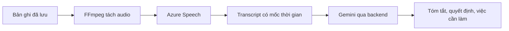

# Nghiên cứu tóm tắt cuộc họp bằng Azure Speech và Gemini

Ngày đối chiếu: 16/11/2026. Tài liệu nghiên cứu và đề xuất; chưa triển khai hoặc gọi dịch vụ bằng dữ liệu cuộc họp.

**Cập nhật sau khi nhóm xác nhận resource `streamora-openai`:** triển khai sử dụng Azure OpenAI thay cho Gemini. Xem [folder buổi học và cấu hình Azure OpenAI](lesson-folders.md). Nội dung dưới đây giữ lại để tham khảo phương án khảo sát ban đầu.

## Kết luận

Đề xuất bổ sung Gemini sau bước tạo transcript hiện có. Azure Speech là dịch vụ nhận dạng giọng nói của Microsoft; Gemini là mô hình của Google. Hai dịch vụ đảm nhận hai công đoạn khác nhau, không phải một sản phẩm có tên "Azure AI Gemini".



MVP thực hiện sau khi bản ghi và transcript sẵn sàng. Chưa thêm xử lý trực tiếp vào luồng Amazon IVS đang họp.

## Hiện trạng xác nhận từ source code

| Thành phần | Hiện trạng |
| --- | --- |
| `class-recordings/azure-speech-transcriber.ts` | Tải bản ghi, FFmpeg tạo PCM mono 16 kHz, gọi Speech SDK continuous recognition; giới hạn đầu vào 120 phút. |
| `class-recordings/recording-transcript.worker.ts` | Lấy việc từ PostgreSQL, claim bằng cập nhật có điều kiện, lease và retry tối đa 3 lần. Ghi transcript khi hoàn tất. |
| `VideoTranscript` trong Prisma | Có trạng thái và `transcriptCues` dạng JSON. |
| `RecordingTranscriptCue` | Có `startMs`, `endMs`, `text`; chưa có tên hoặc ID người nói. |
| `files/recording-transcript.tsx` | Có giao diện transcript, mốc thời gian và phụ đề. |
| Gemini/tóm tắt | Chưa tìm thấy SDK, cấu hình, worker hay bảng dữ liệu tóm tắt trong source hiện tại. |

Lưu ý: bản mô tả kiến trúc cũ đề xuất Azure Batch, nhưng implementation hiện tại dùng Speech SDK continuous recognition. Worker có ghi chú xử lý có thể ở tốc độ thời gian thực; không nên hứa cuộc họp dài một giờ sẽ có transcript sau vài giây.

## Các lựa chọn

| Phương án | Lợi ích | Đánh đổi |
| --- | --- | --- |
| Transcript Azure hiện có → Gemini | Tái sử dụng phụ đề, timestamp, lưu trữ và kiểm tra quyền; không trả thêm phí nhận dạng cho transcript đã có. | Chất lượng tóm tắt phụ thuộc transcript và phải chờ transcript READY. Đây là phương án đề xuất. |
| Audio → Gemini trực tiếp | Có thể hiểu, chép lời và tóm tắt audio bằng một nhà cung cấp. | Cần đánh giá lại phụ đề, timestamp, xử lý file và chi phí audio; gửi audio sang Google thay vì chỉ văn bản. |
| Đổi bước Azure sang Fast/Batch rồi dùng Gemini | Phù hợp khi thời gian xử lý hoặc số lượng bản ghi tăng. | Là thay đổi riêng ở tầng transcription, không cần để ra MVP tóm tắt. |

Gemini hỗ trợ audio input và sinh văn bản theo [tài liệu audio understanding](https://ai.google.dev/gemini-api/docs/audio). Azure Fast trả kết quả đồng bộ nhanh hơn thời gian thực; Batch nhận job và trả kết quả bất đồng bộ, thời gian chờ phụ thuộc tải dịch vụ. Vì vậy Batch không phải lựa chọn bảo đảm nhanh hơn trong mọi trường hợp. Tham khảo [Azure Fast](https://learn.microsoft.com/en-us/azure/ai-services/speech-service/fast-transcription-create) và [Azure Batch](https://learn.microsoft.com/en-us/azure/ai-services/speech-service/batch-transcription).

## Trải nghiệm đề xuất

- Trong trang xem bản ghi: thêm tab **Tóm tắt AI** cạnh **Bản chép lời**.
- Khi chưa có transcript: hiển thị đang tạo bản chép lời; không tạo nội dung suy đoán từ tên cuộc họp.
- Khi transcript READY: người có quyền quản lý chọn **Tạo tóm tắt**. Chỉ tính phí sinh một bản cho cùng phiên bản transcript và cấu hình, không gọi model mỗi lần mở tab.
- Hiển thị tổng quan ngắn, chủ đề chính, quyết định đã chốt, việc cần làm, câu hỏi chưa giải quyết. Với lớp học có thể thêm kiến thức trọng tâm và bài tập.
- Mỗi ý quan trọng có mốc thời gian bấm để xem lại đoạn gốc. Chỉ liên kết những cue đã được backend xác thực tồn tại.
- Giữ nhãn nội dung do AI tạo, cho người quản lý sửa/duyệt và phân biệt bản AI với bản đã biên tập.
- Quyền xem tóm tắt phải theo cùng quyền xem file/bản ghi, bao gồm trạng thái chờ công bố và thu hồi membership; không chỉ ẩn nút ở frontend.

## Thay đổi backend dự kiến

1. Tạo `MeetingSummary` hoặc `FileSummary` gắn `fileId` và khi có thể gắn thêm `sessionId`/`recordingId`. Không giả định một cuộc họp chỉ có một file ghi hình.
2. Lưu trạng thái `PENDING/PROCESSING/READY/FAILED`, bản tóm tắt, nguồn transcript, model, phiên bản prompt và thời điểm sinh. Tách nội dung đã được người dùng sửa để retry không ghi đè bản biên tập.
3. Dùng khóa duy nhất trên file + hash transcript + phiên bản cấu hình; worker có lease và retry có giới hạn. Không giữ HTTP request mở trong lúc chờ AI.
4. Thêm API yêu cầu tạo/tạo lại và đọc kết quả. Trả trạng thái cho frontend polling hoặc phát sự kiện hoàn tất qua realtime hiện có.
5. Dùng adapter cho Gemini để có thể chọn Gemini Developer API trả phí hoặc endpoint Google Cloud theo cấu hình triển khai. Kiến trúc trong repo dự kiến Gemini qua Vertex AI. Không hardcode model trước khi đối chiếu model đang hỗ trợ trong project.
6. Chỉ gửi transcript và metadata tối thiểu. Khóa/API credentials chỉ ở backend; không đưa vào `NEXT_PUBLIC_*`.

Model trả dữ liệu có cấu trúc, ví dụ:

```json
{
  "overview": "...",
  "topics": [{ "title": "...", "cueIndexes": [12, 13] }],
  "decisions": [{ "text": "...", "cueIndexes": [20] }],
  "actionItems": [{ "task": "...", "owner": null, "dueDate": null, "cueIndexes": [24] }],
  "openQuestions": []
}
```

[Structured outputs của Gemini](https://ai.google.dev/gemini-api/docs/structured-output) hỗ trợ JSON Schema. Backend vẫn cần kiểm tra schema, giới hạn độ dài, chỉ số cue và nội dung; JSON hợp lệ không phải bằng chứng nội dung đúng.

## Độ chính xác

- Prompt chỉ cho phép dùng thông tin trong transcript. Chưa chốt thì không được chuyển thành quyết định; không có tên hoặc hạn chót thì trả `null`.
- Transcript hiện tại không có speaker ID. Không suy ra người nói hoặc giao việc từ danh sách người tham gia. Diarization là hạng mục bổ sung và nhãn Speaker 1/2 không tự đồng nghĩa với tài khoản Streamora.
- Xem transcript là dữ liệu, không thực thi các chỉ dẫn nằm trong lời nói của người tham gia. Worker tóm tắt không cần quyền gửi email, chạy lệnh hay thay đổi quyền cuộc họp.
- Với transcript dài: chia theo token và ranh giới cue/chủ đề, có phần chồng lấp; tóm tắt từng phần rồi hợp nhất, giữ nguồn tham chiếu. Với transcript ngắn: ưu tiên một lần gọi để giảm mất ngữ cảnh.
- Không có lời nói, transcript lỗi hoặc thiếu nhiều đoạn: thông báo rõ thay vì tạo một bản tóm tắt có vẻ đầy đủ.
- Cần đánh giá bằng bản ghi tiếng Việt, Việt–Anh xen kẽ, nhiều người nói chồng, tên riêng và thuật ngữ môn học.

## Chi phí và dữ liệu

Chi phí gồm nhận dạng giọng nói nếu chưa có transcript, token Gemini và tài nguyên worker/lưu trữ. [Azure tính phí Speech theo thời lượng audio và gói dịch vụ](https://azure.microsoft.com/en-us/pricing/details/speech/); giá phải chốt theo region/subscription. Gói F0 hiện công bố 5 giờ real-time transcription miễn phí mỗi tháng; Batch không thuộc mức miễn phí này. Cần kiểm tra quota của tài khoản đang dùng, không coi credit sinh viên là bảo đảm mọi SKU đều được cấp.

Ví dụ minh họa theo dòng giá Gemini 2.5 Flash hiện công bố: text input 0,30 USD/triệu token và output gồm thinking 2,50 USD/triệu token. Nếu một lần sinh dùng 20.000 input và tổng 2.000 output/thinking tokens, phí Gemini khoảng **0,011 USD**. Đây không phải dự toán giá toàn bộ cuộc họp và không phải đề xuất khóa model 2.5; model triển khai cần được chọn lại theo khả dụng, chất lượng và giá. Nguồn: [bảng giá Gemini Developer API](https://ai.google.dev/gemini-api/docs/pricing). Giá này không dùng để báo giá Vertex AI/Google Cloud.

Với dữ liệu cuộc họp thật, đề xuất Google Cloud với quyền dịch vụ phù hợp hoặc Gemini API trả phí. Theo [điều khoản Gemini API](https://ai.google.dev/gemini-api/terms), unpaid services có thể dùng nội dung để cải thiện sản phẩm; paid services không dùng prompt/response cho mục đích này, nhưng vẫn có lưu giữ giới hạn phục vụ an toàn/chống lạm dụng. "Không dùng để huấn luyện/cải thiện" không đồng nghĩa "không lưu dữ liệu". [Chính sách dữ liệu Google Cloud](https://cloud.google.com/vertex-ai/generative-ai/docs/data-governance) cũng có điều kiện cụ thể về retention và giám sát lạm dụng.

Đề xuất thông báo việc ghi âm/xử lý AI trong luồng ghi hình, giới hạn quyền đọc, không log transcript/prompt đầy đủ, và xóa dữ liệu tóm tắt liên quan khi xóa bản ghi theo chính sách sản phẩm.

## Phạm vi MVP và kiểm chứng

MVP: tóm tắt sau cuộc họp từ transcript sẵn có, tiếng Việt, tham chiếu timestamp, trạng thái xử lý, quyền backend, lưu kết quả và retry. Chưa làm live summary, nhận diện tên người nói, hỏi đáp toàn bộ kho tài liệu hoặc tạo câu hỏi ôn tập.

Nghiệm thu: người không có quyền không lấy được nội dung; hai lần bấm không sinh hai job; timeout/429 không ảnh hưởng Meeting; transcript thay đổi làm mất hiệu lực cache; quyết định/người được giao/hạn chót đều có bằng chứng; cuộc họp dài không mất các phần cuối. Cần đo độ trễ và token sử dụng trên các bản ghi được phép dùng thử trước khi chọn model mặc định.
