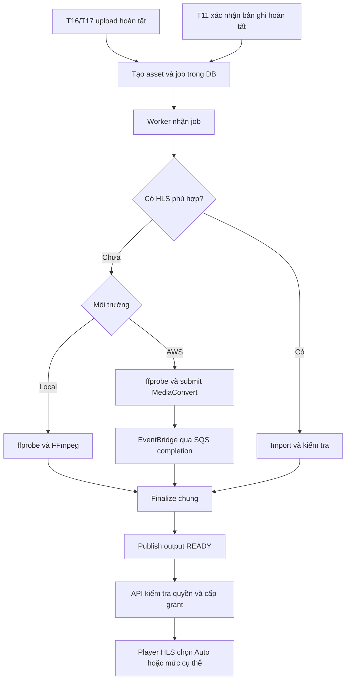

# T13 Preview nhiều chất lượng và pipeline video local cloud

Cập nhật: 13/11/2026. Phụ trách: Cao Anh Đức; phối hợp Nguyễn Hữu Hải Long.

T13 cung cấp chất lượng thật cho preview trong thư viện: **Tự động, 2160p (4K), 1080p, 720p, 360p**, hỗ trợ bật thêm 1440p/480p. Video upload và bản ghi buổi học dùng chung quản lý file, catalog và luồng xem lại. **Giữ FFmpeg để test toàn bộ pipeline local; dùng MediaConvert trên cloud; tận dụng HLS sẵn có từ IVS.**

**Trạng thái triển khai 14/11/2026:** đã thêm hai bảng/migration, job/lease/retry,
transaction upload, worker FFmpeg, kiểm tra/publish HLS, catalog DB, API file/recording,
grant media local và player HLS. Adapter MediaConvert/SQS/completion/reconcile,
signed cookie CloudFront và CloudFormation đã có mã. Xem
[hướng dẫn worker](../services/video-worker/README.md) và
[triển khai AWS](../infra/aws/video/README.md).
Migration chưa được áp vào database ứng dụng. AWS thực, T11 cloud recording-ended
với mapping channel/phiên, LIVE ABR và native HLS thiết bị đích vẫn cần triển khai/
nghiệm thu; chưa đánh dấu T13 hoàn tất toàn bộ.

Bằng chứng local: 17 ca pipeline/DB/queue mô phỏng và 3 ca hồi quy preview đã qua;
browser đã kiểm tra đổi 1080p → 360p → Auto tại giây 30, giữ pause/rate/volume,
giữ mức manual qua refresh, và Auto xuống 360p khi giảm băng thông rồi tua ngoài
buffer đã tải. Bộ preview browser cũ cũng đã qua với `TEST_DATABASE_MODE=embedded`.
Build/typecheck và schema validation đã qua. Bộ backend rộng hơn còn lỗi snapshot
OpenAPI T03 (route chat hiện có khác bản lưu), không phải lỗi pipeline T13.

## 0. T13 bản gốc là tiêu chí bắt buộc

Nguồn đối chiếu: `Streamora_files/job.xlsx`, sheet Phan_cong dòng 18 và API_backend dòng 62–65. Mọi tối ưu phía dưới chỉ thay đổi cách triển khai nội bộ, không cắt yêu cầu gốc. T13 vẫn là P0, giai đoạn 3, phụ thuộc T11/T12/T19.

| Yêu cầu gốc | Thiết kế phải đáp ứng |
| --- | --- |
| Trạng thái, tiến độ khi xác định được, lỗi có thể retry | Trạng thái DB bền vững; progress thật hoặc null; retry có quyền và idempotency |
| Chỉ hiển thị chất lượng thực tế | Menu từ manifest/catalog đã kiểm tra, không gắn 1080p/4K cho nguồn không đáp ứng |
| ABR LIVE qua IVS STANDARD | Cấu hình Channel STANDARD và recording configuration chọn ALL; nghiệm thu tự chuyển mức LIVE riêng với VOD |
| VOD tận dụng rendition IVS | Import HLS đã ghi, không encode lại khi đã phù hợp |
| LOCAL_RECORDING/MP4 qua MediaConvert | Template cloud tạo HLS nhiều mức và thumbnail; FFmpeg chỉ bổ sung cho local |
| SQS, jobId chống trùng, retry giới hạn và DLQ | Giữ contract video.finalize.v1; chỉ xóa message hoàn tất sau output hợp lệ và DB commit thành công |
| VOD ít nhất hai mức khi nguồn đủ | Ca nghiệm thu bắt buộc; không có manifest tham chiếu file thiếu |
| Worker chết/chạy lại không làm trùng hoặc hỏng | Lease/attempt, output prefix riêng, phục hồi job provider đã submit và publish có điều kiện |
| Đủ T13-01 đến T13-04 | Giữ API theo recordingId và queue/pipeline gốc, dùng cùng service nội bộ theo fileId |

4K theo nguồn, menu kiểu YouTube và FFmpeg local là bổ sung theo yêu cầu người dùng, không thay thế tiêu chí trên. Không bắt buộc clone toàn bộ tính năng YouTube. Các phần T12/T14/T18 chỉ tích hợp ở ranh giới cần thiết.

## 1. Phân tích và quyết định tối ưu

Bản đầu đúng ở việc encode ngoài API, dùng lại HLS IVS và bảo vệ toàn cây media. Tuy nhiên số lớp dữ liệu và cơ chế điều phối còn lớn hơn nhu cầu hiện tại.

| Bản đầu | Thiết kế mới | Lợi ích và giới hạn |
| --- | --- | --- |
| Asset + Job + OutputVersion + Rendition + outbox/inbox mới | Chỉ thêm VideoAsset và VideoJob; output là snapshot JSONB của job | Ít bảng/join/migration; phù hợp danh sách rendition nhỏ, chưa phục vụ analytics phức tạp |
| assetId, fileId, outputVersion, attemptId | fileId là định danh nghiệp vụ, jobId là output version, attemptNo chống tiến trình cũ | Giảm mapping, vẫn retry và giữ output cũ được |
| FFmpeg phải có submit bất đồng bộ như AWS | Local worker chạy FFmpeg và chờ; AWS submit rồi nhận completion | Không dựng dịch vụ FFmpeg giả lập MediaConvert |
| Local có queue dispatch/completion | Local poll bảng job; xong encode gọi finalize chung | Không thêm queue hoặc completion service local |
| Outbox riêng để gửi job | VideoJob lưu cả trạng thái cần dispatch | Không mất việc giữa DB commit và gửi queue |
| Nhiều loại worker/service | Một chương trình worker, các vòng lặp theo mode | Dễ chạy và deploy; chỉ tách khi đo được nhu cầu |
| Encode mọi mức mặc định | Mặc định 360/720/1080/2160, bỏ mức vượt nguồn; 480/1440 tùy chọn | Giảm số rendition, thời gian và dung lượng; vẫn chọn mức cụ thể |
| Thumbnail bắt buộc để READY | Thumbnail tùy chọn, lỗi dùng placeholder | Ảnh lỗi không chặn video đã phát được |
| Nhiều MP4 và nhiều codec đầu ra | V1 chỉ HLS H.264/AAC, giữ bản gốc nếu có | Một định dạng playback, không sinh MP4 theo từng mức |
| Nhiều tổ hợp driver và Lambda | Hai mode local/aws; một module; API recording gốc gọi cùng service theo fileId | Giảm số đường đi nội bộ, vẫn giữ hợp đồng T13 |

Vẫn giữ lease, chống trùng, retry giới hạn, kiểm tra quyền và bảo vệ segment. Đây là điều kiện vận hành đúng khi lỗi, không phải chức năng mở rộng.

## 2. Trải nghiệm preview và giới hạn

- `/files` → Preview → Cài đặt → Chất lượng. Menu lấy từ output đã công bố, sắp xếp giảm dần.
- Auto đổi mức theo mạng; hiển thị mức đang phát, ví dụ `Tự động · 720p`. Chọn 720p thì khóa mức đó, không âm thầm về Auto khi mạng yếu.
- Đổi mức giữ thời gian, tốc độ, âm lượng và trạng thái phát/dừng. Có thể đợi tải segment mới.
- Đang encode: phát original nếu trình duyệt hỗ trợ và được phép; không có nguồn phù hợp thì hiện đang xử lý, không tạo menu chất lượng giả.
- Tốc độ phát thuộc player, không cần thêm rendition. Một mức vẫn phát được; không bắt buộc ít nhất hai mức với nguồn rất nhỏ.

| Nguồn ngang 16:9 | Menu khi hoàn tất, cấu hình mặc định |
| --- | --- |
| 3840×2160 | Auto, 2160p (4K), 1080p, 720p, 360p |
| 1920×1080 | Auto, 1080p, 720p, 360p |
| 1280×720 | Auto, 720p, 360p |
| Nhỏ hơn 360p | Một rendition theo kích thước nguồn, không upscale |
| HLS IVS | Mọi mức thực sự có trong metadata và manifest |

Hỗ trợ 1440p/480p bằng policy, không sửa player. Không loại mức có sẵn trong IVS chỉ vì không thuộc ladder encode mặc định.

4K là UHD 3840×2160; không tạo 4K thật từ nguồn 1080p. IVS Low-Latency STANDARD hiện tối đa 1080p [1]. Muốn bản ghi 4K cần nguồn 4K riêng, ví dụ bản ghi cục bộ upload thành file riêng. Livestream 4K nằm ngoài T13 V1.

Nguồn dọc/tỷ lệ khác: normalize rotation và sample aspect ratio, giữ tỷ lệ, kích thước chẵn; dùng khung profile ngang/dọc tương ứng, không kéo giãn/upscale. Lưu width/height thật; nhãn theo cạnh ngắn, riêng 4K phải đáp ứng UHD ngang hoặc dọc. Cần sửa logic UI hiện dựa height và nghiệm thu dọc riêng.

V1 nghiệm thu nguồn SDR thông thường, đầu ra tối đa 4K/30 FPS. HDR/10-bit cần chuyển màu đã xác minh hoặc trả lỗi rõ. HEVC/AV1, 60 FPS, nhiều track audio, ghép/thay nguồn và MP4 export để sau.

## 3. Kiến trúc tối thiểu

Một NestJS module và một chương trình worker tách khỏi tiến trình API. Tái sử dụng Files/Uploads/Storage và PostgreSQL. Database là nguồn sự thật, SQS là phương tiện giao việc trên cloud.



| Thành phần | Local | AWS |
| --- | --- | --- |
| Metadata/job | PostgreSQL | RDS PostgreSQL |
| Nhận việc | Poll VideoJob, claim bằng lease | VideoJob pending-dispatch → SQS dispatch |
| Encode | FFmpeg trong worker | MediaConvert |
| Metadata nguồn FILE | ffprobe | ffprobe trên nguồn S3 được backend cấp quyền |
| Hoàn tất | Gọi finalize trực tiếp | EventBridge → SQS completion → cùng finalize |
| Storage | Filesystem hiện có | S3 private |
| HLS delivery | Endpoint local có grant | CloudFront signed cookie |
| LIVE | Fixture kiểm tra import | IVS thật |

Cloud vẫn cần ffprobe để biết kích thước/codec trước khi tạo ladder tường minh, nhưng không chạy FFmpeg encode trên EC2. Không tin metadata client. HLS có metadata tin cậy từ T11/IVS không phải probe lại toàn video [7].

Không thêm Redis, RabbitMQ, Kafka, MinIO, LocalStack, Kubernetes hoặc dịch vụ FFmpeg HTTP. Không bắt buộc Docker. Hai mode là preset nhất quán, không mở mọi tổ hợp queue/encoder/delivery từ đầu.

## 4. Luồng hoạt động cụ thể

### Upload hoặc bản ghi cục bộ

1. T16/T17 xác nhận nguồn hoàn chỉnh. MP4 có thể mang source DOCUMENT; nhận diện video bằng nội dung/probe, không chỉ source hoặc đuôi file.
2. Trong transaction hoàn tất metadata, gọi service nội bộ để upsert VideoAsset và tạo VideoJob QUEUED. Upload complete lặp trả cùng file/job. Không encode hoặc gửi queue best-effort trong response.
3. Pin nguồn bằng FileUsage hiện có. Worker đọc nguồn từ DB, probe codec/kích thước/FPS/audio/thời lượng, chọn profile và lưu policy snapshot.
4. Local chạy FFmpeg ra prefix riêng. AWS ghi ý định submit, tạo MediaConvert job, lưu providerJobId rồi kết thúc bước dispatch.
5. Finalize xác minh HLS, commit output READY và publishedJobId trong cùng transaction. Nhả FileUsage khi terminal; cleanup output lỗi theo retention.

File AVAILABLE nghĩa là upload đã lưu; không đồng nghĩa video READY. Nếu flow complete hiện tại chưa cho phép cùng transaction, phải sửa điểm nối trước khi triển khai.

### Bản ghi livestream

T05 quản lý media; T11 điều khiển ghi. Với broadcast: composition → IVS Channel STANDARD → auto-record S3. T11 nhận sự kiện kết thúc bản ghi, đăng ký file và job IMPORT_HLS. Không tạo job trên mỗi segment/object mới.

Worker đọc metadata IVS, tìm đúng master/rendition, kiểm tra rồi finalize; không HLS → MP4 → HLS và không gọi MediaConvert nếu output đã phù hợp [2]. Với composition ghi trực tiếp S3, T11 khai báo SourceRef theo đầu ra thực tế; chỉ transcode khi nguồn được encoder hỗ trợ [3].

Giữ prefix IVS và mapping catalog; không copy cả video chỉ để đổi tên thư mục. Delivery phải ánh xạ đúng prefix được phép. Mỗi lần ghi là một file theo T11/T15; bản cục bộ chất lượng cao hơn là file riêng trong V1, không tự gộp theo tên.

### Preview và xem lại

API playback kiểm tra membership hiện tại, đọc publishedJobId/output, cấp grant toàn cây HLS; player dùng master/variant. Upload và bản ghi dùng cùng luồng này. Nếu job mới đang xử lý/lỗi mà có output cũ, vẫn phát output cũ; trạng thái processing nói về job mới.

DVR đang LIVE thuộc T12, dùng playlist đang tăng và khoảng tua đã xác minh, không chờ VOD. Fixture local không chứng minh IVS DVR chạy. T13 không nhận thêm scope phòng học, replication hoặc failover CDN của T18.

## 5. Chỉ hai bảng mới

Reuse LibraryFile, StorageLocation, RecordingAsset/ClassRecording và FileUsage; không tạo thư viện hoặc recording model mới.

| Entity | Dữ liệu |
| --- | --- |
| VideoAsset | fileId PK/FK, source JSONB có runtime schema (FILE/HLS, storageLocationId, key/prefix/masterKey), sourceMetadata đã xác minh, currentJobId, publishedJobId |
| VideoJob | id, fileId, mode TRANSCODE/IMPORT_HLS, encoder, state, policy snapshot/version, providerJobId, attemptNo, leaseOwner/leaseUntil, nextRunAt, lastDispatchAt, delivery/error counters, progressPercent/errorCode, timestamps, output JSONB, retry idempotency key hash/actor |

Source bất biến trong V1. FK/transaction bảo đảm job reference thuộc đúng fileId. Soft delete theo LibraryFile, không thêm trạng thái xóa riêng.

**jobId chính là output version.** Retry nghiệp vụ tạo job mới; retry kỹ thuật cùng job chỉ tăng attemptNo khi chắc chắn phải encode lại. Mỗi attempt ghi prefix riêng. Không thêm bảng OutputVersion/Rendition/Attempt. Output JSONB chứa storageLocationId, prefix/masterKey, duration, rendition metadata/variantKey và thumbnailKey tùy chọn; không lưu URL ký.

State nội bộ: QUEUED → SUBMITTING → PROCESSING → VERIFYING → READY/FAILED. IMPORT_HLS bỏ qua bước submit. Snapshot READY bất biến, publishedJobId chỉ trỏ READY; partial unique index chặn hai job active cùng file. Lock ngắn khi tạo/publish, không giữ transaction qua I/O dài.

Public giữ NOT_REQUESTED/QUEUED/PROCESSING/READY/FAILED; SUBMITTING/VERIFYING map PROCESSING. currentJobId quyết định processing, publishedJobId quyết định có nguồn phát. ClassRecording.SAVED không tự biến thành processing READY.

JSONB phù hợp vì UI đọc toàn bộ danh sách nhỏ; đánh đổi là chưa tối ưu analytics theo từng rendition. Chưa có nhu cầu thì chưa chuẩn hóa thành nhiều bảng.

## 6. Điều phối, retry và chống trùng

### Local

VideoJob là queue bền vững. Worker poll khi nhàn khoảng 1–2 giây, claim bằng transaction SKIP LOCKED và lease; concurrency mặc định 1. FFmpeg chạy bằng spawn với mảng tham số, `-nostdin`, đọc `-progress pipe:1`; không ghép shell command [8].

Progress từ thời gian encode/thời lượng nguồn, cap dưới 100 đến khi finalize; cập nhật DB có giới hạn khoảng 1–2 giây/lần. Không đo được thì null. Giới hạn threads, timeout, scratch và số process.

Heartbeat giữ lease; leaseOwner/attemptNo là fencing token. Mất lease phải dừng process. Worker chết thì lần chạy sau nhận lại, ghi attempt mới; process cũ không được publish. Không cần completion queue hoặc API FFmpeg riêng.

### AWS

Giữ **hai SQS queue dispatch/completion, mỗi queue có DLQ**, vì hai loại công việc có retry và backlog khác nhau. Chúng dùng chung chương trình worker với các vòng lặp, không cần nhiều service deployment.

1. Dispatcher đọc job QUEUED cần gửi và enqueue contract `video.finalize.v1` của T13-03. Job row là outbox chuyên dụng. Gửi xong nhưng chưa ghi lastDispatchAt có thể gửi lặp, không mất việc.
2. Consumer claim DB, probe, lưu policy và ý định SUBMITTING. CreateJob dùng ClientRequestToken theo job/attempt; UserMetadata chứa project/jobId/attemptNo.
3. **Chưa xóa message video.finalize.v1 khi mới submit.** Gia hạn visibility trong lúc job đang chạy, với khoảng gia hạn có giới hạn và dưới giới hạn SQS; không giữ transaction DB hoặc chặn luồng xử lý trong lúc chờ. Worker lưu providerJobId để restart/redelivery chỉ tiếp tục theo dõi job đã có, không submit lại.
4. EventBridge chỉ nhận job Streamora, chuyển COMPLETE/ERROR/CANCELED và progress nếu dùng vào completion queue; queue policy giới hạn rule/account.
5. Completion consumer đối chiếu account/region/job/attempt/provider, finalize rồi mới ack sự kiện completion. Worker đang giữ receipt của video.finalize.v1 thấy READY sau commit mới xóa message gốc; nếu receipt mất hiệu lực thì lần nhận lại đọc READY và xóa an toàn. ERROR/CANCELED ghi FAILED có điều kiện; message gốc được retry có kiểm soát hoặc chuyển DLQ theo policy, không xóa như thể thành công.

Không dùng số lần poll trạng thái làm số lần encode retry. maxReceiveCount/visibility phải đủ cho thời lượng xử lý dự kiến; gia hạn có heartbeat, worker chết thì message xuất hiện lại. Giới hạn số job đang theo dõi để không giữ quá nhiều message in-flight. Nếu cần đổi sang ack ngay sau handoff bền vững ở phiên bản sau thì phải sửa rõ hợp đồng gốc trước, không áp dụng âm thầm trong T13 này.

Payload T13-03 cho bản ghi giữ `{jobId,recordingId,sourceObjectKey,outputVersion,requestedAt}`. Resolve nguồn từ DB; sourceObjectKey chỉ để đối chiếu, không tin dữ liệu client. outputVersion có thể dùng jobId làm định danh phiên bản nếu schema được chốt tương thích. Video upload không có recordingId dùng cùng service/job store theo fileId và envelope nội bộ riêng, không giả tạo recordingId hoặc thay payload gốc.

Completion có thể đến trước khi response submit được lưu. Resolve bằng UserMetadata tới job đã tồn tại, GetJob xác minh provider/settings/prefix; lưu mapping và finalize. Handler submit cập nhật có điều kiện để không ghi đè terminal state. Không cần inbox table mới chỉ cho tình huống này [5].

**Không hứa exactly-once:** MediaConvert ClientRequestToken chỉ chống request lặp trong một phút sau request thành công [6]. Submit không rõ kết quả vượt cửa sổ đó phải reconcile bằng providerJobId hoặc tìm job trong queue ứng dụng và đối chiếu metadata/attempt trước khi gửi lại. Chưa đủ bằng chứng thì giữ SUBMITTING và cảnh báo, không tự encode trùng. DB bảo đảm chỉ một output được publish.

Reconcile là vòng lặp trong cùng worker: query job kẹt có backoff, hoàn tất lại job COMPLETE, gửi lại job QUEUED quá hạn. Cloud submission concurrency khác số job MediaConvert in-flight; đặt giới hạn in-flight theo quota/ngân sách đã đo.

Chặn side effect lặp bằng job/attempt/provider và state terminal bất biến, không cần dedupe table chung. Retry lỗi mạng có backoff/giới hạn; nguồn hỏng trả FAILED, không retry vô hạn. DLQ dành cho message không xử lý được, không thay thế lỗi nghiệp vụ DB.

## 7. Encode, output và publish

V1 dùng HLS H.264/AAC, đầu ra cap 30 FPS và không vượt FPS nguồn. Nguồn không audio vẫn hợp lệ; nguồn chỉ audio không thuộc pipeline video. Giữ file original để download nếu có, không sinh MP4 riêng từng mức. Template MediaConvert bắt buộc có output thumbnail theo T13 gốc; placeholder chỉ là cách hiển thị tạm khi thumbnail chưa sẵn sàng, không phải bỏ tính năng tạo thumbnail.

| Profile | Khung ngang | Bitrate video tham khảo | Mặc định |
| --- | --- | --- | --- |
| 2160p | 3840×2160 | 18–25 Mbps | Khi nguồn/cap đủ |
| 1440p | 2560×1440 | 9–14 Mbps | Tùy chọn |
| 1080p | 1920×1080 | 4.5–8 Mbps | Khi nguồn/cap đủ |
| 720p | 1280×720 | 2.5–4 Mbps | Khi nguồn/cap đủ |
| 480p | 854×480 | 1–2 Mbps | Tùy chọn |
| 360p | 640×360 | 0.6–1 Mbps | Khi nguồn/cap đủ |

Bitrate là điểm khởi đầu để đo, không phải tiêu chuẩn hoặc báo giá. Nếu không profile nào vừa nguồn, tạo một mức nguồn tương thích. Encode các mức trong một job, không job riêng từng mức. FFmpeg có thể chia một luồng decode ra nhiều scale/encoder; giới hạn threads và đo RAM khi thử 4K.

Segment khoảng 4 giây; keyframe/ranh giới segment đồng bộ giữa các mức và cùng timeline. RESOLUTION/BANDWIDTH/CODECS theo output thật. Policy snapshot cố định từng job; local/cloud không cần byte-identical nhưng phải đáp ứng cùng quy tắc.

```text
groups/<groupId>/videos/<fileId>/<jobId>/<attemptNo>/
  hls/master.m3u8
  hls/1080p/index.m3u8
  hls/1080p/segment-00001.ts
  hls/720p/index.m3u8
  hls/720p/segment-00001.ts
  thumbnails/poster.jpg
```

Finalize đọc master/playlist con, chặn reference ngoài asset/version, đối chiếu segment/init/audio tồn tại và metadata đúng policy. Cloud list prefix có phân trang để kiểm tra nhiều segment thay vì HEAD từng file; local kiểm tra file theo manifest. Không đọc lại toàn bộ byte video trong completion handler.

Publish sau khi mọi mức bắt buộc hoàn tất; master ghi sau dữ liệu. IVS import theo rendition thực tế, không ép ladder encode. Thumbnail thiếu dùng placeholder. Thiếu segment thì không READY, retry kiểm tra có giới hạn. Commit READY/publishedJobId có điều kiện đúng attempt và file còn hợp lệ, không cần rename thư mục S3.

Bám FileUsage/deletion policy hiện có; không publish file DELETED hoặc làm file xuất hiện lại. Dọn attempt lỗi/output cũ theo retention, không xóa ngay trong retry hoặc khi grant cũ còn hiệu lực.

## 8. Điểm nối source, API và delivery

| Source hiện có | Công việc T13 |
| --- | --- |
| `backend/contracts/src/files.ts` | Giữ playback shape, bổ sung quality/output metadata và grant cần thiết |
| `backend/src/modules/files/video-rendition-catalog.ts` | DatabaseVideoCatalog đọc published output |
| `backend/src/modules/files/video-playback.service.ts` | HLS-only, không luôn ký original trước; nối delivery |
| `frontend/src/components/files/video-preview.tsx` | Reuse hls.js, chọn level, restore; bổ sung active quality/refresh |
| `frontend/src/components/files/video-player-controls.tsx` | Menu thật, nhãn 4K/video dọc |
| `backend/src/modules/files/storage-locations.service.ts` | Reuse source/output location, không thêm registry |

**Khoảng trống bắt buộc:** LibraryFile.objectKey và validation/download hiện thiên về file đơn. HLS-only phải có source descriptor và download capability đúng; không tạo MP4 giả, không gắn MIME MP4 cho HLS hoặc cấp master như thể tải được cả video. Cần sửa service/validation/UI và kiểm thử tương thích khi nối T11.

API bắt buộc theo T13 gốc:

- **T13-01:** `GET /api/v1/recordings/:recordingId/processing`, MEMBER/ADMIN, trả `{status,progressPercent,renditions:[{height,bitrate,status}],thumbnailReady,errorCode?}`; progress null khi chưa biết, lỗi 403/404.
- **T13-02:** `POST /api/v1/recordings/:recordingId/processing/retry`, HOST/OWNER/ADMIN, header Idempotency-Key và body `{}`; chỉ FAILED, trả `202 {jobId,status:"QUEUED"}`; lỗi 403/404/409 JOB_NOT_RETRYABLE.
- **T13-03:** consumer/producer `video.finalize.v1` trên SQS theo hợp đồng ở mục 6; mã lỗi SOURCE_MISSING/ENCODE_FAILED/STORAGE_FAILED.
- **T13-04:** pipeline nội bộ IVS Channel STANDARD, recording lưu đủ rendition thực tế; phát hiện CHANNEL_NOT_STANDARD/RENDITION_MISSING.

Controller recording resolve quyền và recording → file rồi gọi cùng service; không tạo bảng/job/pipeline thứ hai. Các endpoint theo fileId dưới đây phục vụ thư viện upload và tái sử dụng code, không thay API recording gốc:

- Giữ `POST /api/v1/files/:fileId/playback`: kiểm tra quyền, trả processing/sources/grant, cho phép không có original.
- Thêm `GET /api/v1/files/:fileId/processing`: chỉ metadata để poll, không ký lại media URL mỗi lần.
- Thêm `POST /api/v1/files/:fileId/processing/retry`: HOST/OWNER của group hoặc ADMIN, chỉ FAILED; Idempotency-Key bắt buộc. Cùng key/actor/file trả cùng job; key mới chỉ tạo job nếu không có active job.

Không nhận objectKey/URL/profile tùy ý từ client. Lỗi 403/404/409 theo quy ước hiện có. Không thêm API rendition CRUD hoặc encode riêng. API recording gốc được giữ để đáp ứng phân công, không cần sửa task sheet chỉ vì tổ chức service nội bộ theo fileId.

Player đọc levels từ master, map theo identity/kích thước thay vì giữ index qua refresh. Auto/manual dùng engine thật. Native HLS fallback cần variant URL đã cấp quyền để chọn manual; chưa chạy ổn trên thiết bị đã chọn thì ghi rõ ca chưa đạt, không hiện lựa chọn giả.

Local dùng media endpoint với grant cookie HttpOnly scope asset/version, ưu tiên cùng origin qua proxy. Cloud dùng CloudFront signed cookie và S3 private/OAC. Bảo vệ playlist con, segment, init/audio và thumbnail; ký riêng master là chưa đủ.

Giữ grant tối đa 60 giây theo policy hiện có; chủ động gia hạn khi đang preview và kiểm tra lại membership. Grant/buffer quyết định độ trễ thu hồi; không thể thu hồi dữ liệu đã tải. Processing poll 3–5 giây chỉ khi đang xử lý, timer grant riêng; đóng preview dừng cả hai. 403 thì dừng, không retry vô hạn.

Credentials/CORS theo origin cụ thể, cookie cấp qua media domain phù hợp. Không lưu/log URL ký; kiểm tra path/protocol/chéo group, hỗ trợ stream/Range, không nạp cả video vào RAM.

## 9. Khung triển khai và cấu hình đề xuất

```text
backend/src/modules/video-processing/
  video-processing.module.ts
  video-processing.service.ts     # tạo/retry job, trạng thái, publish
  video-worker.ts                 # các vòng lặp theo mode
  video-policy.ts                 # ladder và runtime validation
  video-probe.ts                  # ffprobe cho nguồn FILE
  video-finalizer.ts              # kiểm tra/publish chung
  database-video-catalog.ts
  ffmpeg-encoder.ts
  mediaconvert-encoder.ts
  video-delivery.ts               # grant local/cloudfront
backend/services/video-worker/    # entry point dùng cùng module/config/DB
backend/infra/aws/video/           # IaC SQS/DLQ/MC/EventBridge/CDN/IAM
```

Chỉ trừu tượng hóa chỗ có hai implementation thật: encode/storage/delivery. Không tạo sẵn queue framework hoặc nhiều tầng ports/adapters. FFmpeg `run()` chờ output; MediaConvert `submit()` trả providerJobId, `inspect()` phục vụ reconcile. Cùng policy và cấu trúc output, cùng `finalize(jobId,attemptNo,output)`; không ép cùng vòng đời.

### Local

```dotenv
FILES_STORAGE_DRIVER=local
FILES_LOCAL_DIRECTORY=.local-storage/files
VIDEO_MODE=local
VIDEO_MAX_QUALITY=1080
VIDEO_FFMPEG_PATH=ffmpeg
VIDEO_FFPROBE_PATH=ffprobe
VIDEO_SCRATCH_DIRECTORY=.local-storage/video-scratch
```

### AWS

```dotenv
FILES_STORAGE_DRIVER=s3
FILES_S3_BUCKET=<source-bucket>
FILES_S3_REGION=<region>
VIDEO_MODE=aws
VIDEO_MAX_QUALITY=2160
VIDEO_FFPROBE_PATH=ffprobe
VIDEO_DISPATCH_QUEUE_URL=<dispatch-queue>
VIDEO_COMPLETION_QUEUE_URL=<completion-queue>
VIDEO_OUTPUT_BUCKET=<output-bucket>
VIDEO_MEDIACONVERT_ROLE_ARN=<role-arn>
VIDEO_MEDIA_DOMAIN=<media-domain>
VIDEO_SIGNING_SECRET_ARN=<secret-arn>
```

FILES_* đã có; VIDEO_* là đề xuất, cần config schema/validation. VIDEO_MAX_QUALITY là cap profile theo cạnh ngắn, không ép upscale; test 4K dùng 2160. Concurrency local=1, ladder, poll/lease/backoff/retention có default trong config; chỉ thêm env override khi cần.

Probe S3 dùng URL backend sinh cho nguồn tin cậy; giới hạn protocol/redirect, timeout, probe và scratch. Đảm bảo nguồn có thể seek/range; nếu cần tải scratch phải có quota/kích thước tối đa và cleanup. Không nhận URL người dùng hoặc log URL ký [7]. Local path resolve theo backend root; kiểm tra executable/config lúc startup. Cloud dùng IAM role/Secrets Manager server-side.

## 10. Thứ tự triển khai, kiểm thử và giới hạn

**Giai đoạn 1 — local thật:** hai bảng/migration → transaction nối T16/T17 → worker FFmpeg/finalizer/catalog → media grant → player. Test 1080p trước, clip 4K ngắn sau. Thêm script đề xuất `npm run dev:video-worker`; reconcile chạy trong worker, không cần service riêng. Fixture HLS/recording-ended chỉ qua harness test nội bộ.

**Giai đoạn 2 — AWS:** IaC và mode aws → MediaConvert/completion → private CDN → nối IVS recording → smoke test. Reuse RDS/EC2 theo T19, không thêm Lambda/Kubernetes mặc định. Một chương trình worker, chưa cần tách deployment theo vai trò. T12 nhận DVR, T18 nhận replication/failover và tự checkpoint published output khi được triển khai.

Đổi env không tạo hạ tầng hoặc di chuyển file. Source/output giữ storageLocationId; dữ liệu local muốn đưa cloud phải copy, kiểm tra rồi cập nhật mapping. Không đổi binding cũ bằng FILES_STORAGE_DRIVER.

| Ca nghiệm thu | Kết quả |
| --- | --- |
| Nguồn 4K, cap 2160 | Output 2160 thật, menu 4K và mức mặc định phù hợp |
| 1080/720, nguồn nhỏ, dọc/rotation | Không upscale, nhãn đúng, giữ tỷ lệ; một mức vẫn phát |
| Đổi 1080 → 360 → Auto tại giây 30 | Sai lệch playhead tối đa 1 giây sau ổn định, giữ pause/rate/volume; throttle mạng thấy Auto đổi mức |
| IVS HLS đủ | Import mức thực tế, không có MediaConvert dư |
| Nguồn đủ chất lượng | VOD có ít nhất hai mức thật; manifest không tham chiếu object thiếu |
| ABR LIVE và VOD | Hai ca riêng: thay băng thông làm player tự chuyển rendition; LIVE dùng Channel STANDARD và ghi đủ rendition |
| T13-01/02/03/04 | Đúng API, quyền, payload và lỗi gốc; xóa message finalize chỉ sau output + DB commit |
| Thumbnail MediaConvert | Job tạo thumbnail thật và thumbnailReady phản ánh đúng |
| Nguồn hỏng/HDR chưa hỗ trợ | Lỗi rõ, không retry vô hạn hoặc READY giả |
| Master có, segment thiếu | Không publish; kiểm tra lại có giới hạn |
| Worker chết/lease hết/queue lặp/completion sớm | Không mất việc, chỉ attempt hợp lệ publish, terminal state không lùi |
| Submit không rõ kết quả quá 1 phút | Reconcile trước khi gửi lại, không tự tạo encode trùng |
| Thumbnail thiếu | Video vẫn phát bằng placeholder |
| Retry cùng idempotency key | Trả cùng job |
| Grant expiry/thu hồi membership | Gia hạn kiểm tra quyền, 403 dừng; chặn mọi segment chéo group |
| HLS-only từ T11 | Preview không cần MP4 giả, download capability đúng |
| Native HLS thiết bị đích | Auto/manual thật hoặc ghi rõ chưa nghiệm thu đủ |
| AWS smoke test | Upload và IVS record phát nhiều mức qua CDN private thật |

Dùng `npm run test:video-preview` hiện có làm hồi quy, bổ sung test pipeline trong DB riêng. Fixture không thay kiểm thử cloud. T13 hoàn tất cần local thật, cloud thật và ca lỗi/quyền/recovery có bằng chứng.

**Để sau:** publish mức thấp trước rồi bổ sung 4K; HEVC/AV1/HDR/60 FPS; MP4 export; ghép/thay nguồn; worker tách theo tải; analytics rendition và event bus chung.

Đánh đổi V1: chờ cả ladder của job xong mới publish, trong lúc chờ xem original nếu tương thích. Điều này giữ pipeline nhỏ; đo thời gian encode/buffering trước khi thêm công bố từng mức. Chưa có benchmark hoặc chi phí thực đo, không khẳng định tiết kiệm một tỷ lệ cụ thể.

## 11. Nguồn và điểm nối

- [Preview hiện tại](video-preview-local.md), [T16](t16-handoff.md), [T17](t17-handoff.md), [T05](t05-handoff.md), [quy ước backend](backend-conventions.md).
- [Worker hiện tại](../services/video-worker/README.md), [recording](../services/recording/README.md); README recording có thể chậm hơn source class-recordings.
- [1] [IVS streaming configuration](https://docs.aws.amazon.com/ivs/latest/LowLatencyUserGuide/streaming-config.html).
- [2] [IVS auto-record S3 và rendition metadata](https://docs.aws.amazon.com/ivs/latest/LowLatencyUserGuide/record-to-s3.html).
- [3] [IVS composition](https://docs.aws.amazon.com/ivs/latest/RealTimeUserGuide/server-side-composition.html).
- [5] [MediaConvert COMPLETE và UserMetadata](https://docs.aws.amazon.com/mediaconvert/latest/ug/ev_status_complete.html).
- [6] [MediaConvert token chống job trùng](https://docs.aws.amazon.com/mediaconvert/latest/apireference/idempotency.html).
- [7] [ffprobe](https://ffmpeg.org/ffprobe.html).
- [8] [FFmpeg progress và tùy chọn chạy](https://www.ffmpeg.org/ffmpeg.html).
- [hls.js levels](https://hlsjs.video-dev.org/api-docs/hls.js.hls.levels), [currentLevel](https://hlsjs.video-dev.org/api-docs/hls.js.hls.currentlevel).

Số bảng, mode, ladder và bitrate là quyết định thiết kế Streamora; tài liệu dịch vụ đối chiếu ngày 13/11/2026.
