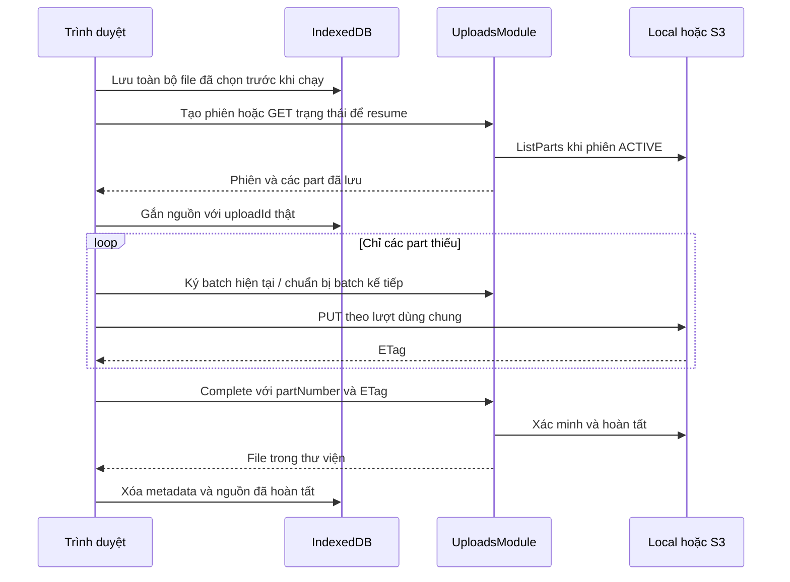

# T17 — Bàn giao tiếp tục upload sau mất mạng và reload

Ngày cập nhật: **13/11/2026**. Các kết quả trước đợt này là bằng chứng lịch sử.

Tài liệu mô tả code trong working tree tại thời điểm bàn giao; các thay đổi T17 chưa
được chốt thành commit/PR trong đợt bàn giao này. Local đã có triển khai và kiểm thử.
AWS dùng lại adapter/cấu hình mẫu của T16, **chưa triển khai hạ tầng hay nghiệm thu S3 thật**.
Đọc cùng [bàn giao T16](t16-handoff.md) cho nền tảng multipart và
[bàn giao T15](t15-handoff.md) cho thư viện/quyền truy cập file.

## Tóm tắt kết quả

| Hạng mục                                                              | Trạng thái bàn giao                                                |
| --------------------------------------------------------------------- | ------------------------------------------------------------------ |
| Tiếp tục upload bằng danh sách part thực tế của storage               | Đã triển khai local; dùng chung hợp đồng với S3                    |
| Pause ngay, resume giữ mốc tiến độ hiển thị                           | Đã triển khai và kiểm thử                                          |
| Reload khôi phục nguồn và toàn bộ hàng đợi, kể cả file chưa tạo phiên | Đã triển khai; trở về trạng thái pause                             |
| Tiếp tục trực tiếp không chọn lại file                                | Có, nếu nguồn đã lưu còn đọc được; handle có thể cần cấp lại quyền |
| Hàng đợi nhiều file, xử lý phản hồi đầy quota                         | Đã kiểm thử với 6 file và 2 phiên pause có sẵn                     |
| Nhường lượt khi retry, ký URL trước một batch, chia lượt theo file    | Đã triển khai và có kiểm thử riêng                                 |
| Dọn phiên hết hạn và phục hồi hoàn tất khi DB chưa cập nhật           | Đã triển khai                                                      |
| Chặn VIEWER upload; xác nhận xóa vĩnh viễn tài liệu                   | Đã triển khai trong đợt T17                                        |
| Tách quota phiên chưa hoàn tất khỏi số file đang truyền               | Chưa triển khai; xem giới hạn cuối tài liệu                        |
| Benchmark thông lượng thực tế/S3 thật                                 | Chưa nghiệm thu; không cam kết mức tăng MB/s                       |

## Phạm vi và thiết kế

Đối chiếu T17 và T17-01..03 trong `Streamora_files/Job.xlsx` (bản người dùng cung cấp).
Giữ module uploads của T16, không thêm hệ thống upload hay scheduler thứ hai.
Phần resume gốc không đổi schema. Bản mở rộng thư mục hiện cần migration
`20261113000100_file_folders` theo T15/T16; không tự chuyển driver sang AWS và không sửa workbook công việc.

| Yêu cầu | Triển khai                                                                                                                                |
| ------- | ----------------------------------------------------------------------------------------------------------------------------------------- |
| T17-01  | `GET /api/v1/uploads/:uploadId`, đăng nhập, kiểm tra chủ phiên/ADMIN và quyền upload trong nhóm trước và sau storage I/O                  |
| T17-02  | Dùng lại sign/complete/abort T16; client gửi phần thiếu, ký lại URL khi retry; complete vẫn kiểm tra parts thực tế                        |
| T17-03  | `UploadsService.cleanupExpired({cutoffAt, limit})`, trả `{scanned, aborted, failed}`; timer nội bộ 30 giây, batch mặc định 20, tối đa 100 |

API status trả uploadId, status, groupId, filename, size, fingerprint, partSize,
totalParts, expiresAt, uploadedParts `{partNumber,etag,size}` và fileId nếu đã hoàn tất.
ACTIVE chưa hết hạn đọc ListParts; COMPLETED/ABORTED không gọi storage.
Phiên chưa kết thúc nhưng hết hạn trả 410 UPLOAD_EXPIRED. Mất storage trả 503.
Quyền nhóm bị thu hồi chặn status/sign/complete; chủ phiên vẫn có thể abort qua cơ chế T16.
S3 ListParts giữ phân trang sẵn có; không lấy ETag/tiến độ trong trình duyệt làm nguồn sự thật.

Nếu S3 đã complete nhưng DB chưa ghi thành công, status nhận NoSuchUpload và xác minh
HeadObject đúng kích thước trước khi trả `objectReady=true`. Client gọi complete với
`parts:[]` để phục hồi DB; nếu object chưa tồn tại, payload rỗng vẫn bị từ chối bởi
kiểm tra số parts trong service. Local dùng lại parts/HeadObject tương đương của T16.

### API để tích hợp

Mọi đường dẫn dưới đây có tiền tố `/api/v1`, cần đăng nhập và giữ cơ chế kiểm tra
chủ phiên/quyền nhóm của T16. Bytes được PUT trực tiếp tới URL storage đã ký.

| Method | Đường dẫn                       | Mục đích                                                              |
| ------ | ------------------------------- | --------------------------------------------------------------------- |
| POST   | `/uploads`                      | Tạo phiên từ metadata; server kiểm tra quyền/quota                    |
| GET    | `/uploads/:uploadId`            | API T17: lấy trạng thái và part thực tế                               |
| POST   | `/uploads/:uploadId/parts/sign` | Ký URL; API nhận tối đa 8 part, client dùng 5                         |
| POST   | `/uploads/:uploadId/complete`   | Xác minh/hoàn tất; cần `Idempotency-Key` hợp lệ, client dùng uploadId |
| DELETE | `/uploads/:uploadId`            | Hủy phiên và dọn dữ liệu dở; không dùng cho pause                     |

Ví dụ payload trả về khi resume một phiên còn hoạt động:

```json
{
  "uploadId": "11111111-1111-4111-8111-111111111111",
  "status": "ACTIVE",
  "groupId": "22222222-2222-4222-8222-222222222222",
  "filename": "tai-lieu.pdf",
  "size": 16777216,
  "fingerprint": "sha256-tree-v1:<64 ky tu hex>",
  "partSize": 8388608,
  "totalParts": 2,
  "expiresAt": "2026-11-10T00:00:00.000Z",
  "objectReady": false,
  "uploadedParts": [{ "partNumber": 1, "etag": "etag-part-1", "size": 8388608 }]
}
```

Ví dụ trên là dữ liệu minh họa cấu trúc, không phải phiên thật. Client chỉ gửi part 2;
khi complete gửi cả part 1 và 2 dưới dạng `{partNumber, etag}`, không kèm `size`.
`COMPLETED` có thể có `fileId`; `objectReady=true` dùng để phục hồi hoàn tất như mô tả trên.



Đối với resume, GET status bắt đầu song song với xác minh fingerprint; khôi phục từ
nguồn đã lưu không tạo thêm uploadId. Trình tự trên chỉ lược bỏ chi tiết song song này.

## Cách dùng local

Giữ cấu hình T16: `FILES_STORAGE_DRIVER=local`, thư mục file và cổng upload local hiện tại.
Chạy API/frontend như trước; áp migration thư mục mới của T15/T16 trước khi chạy bản hiện tại.

### Khởi động từ thư mục gốc repository

Nếu máy chưa có dependencies/file môi trường:

```powershell
npm install
npm run setup:env
```

Điền cấu hình PostgreSQL/auth đang dùng theo hướng dẫn T16. Những khóa dưới đây là
phần cần đối chiếu trong `backend/.env` hiện có, **không phải toàn bộ file môi trường**:

```dotenv
API_PORT=4000
WEB_ORIGIN=http://127.0.0.1:3000
FILES_STORAGE_DRIVER=local
FILES_LOCAL_DIRECTORY=.local-storage/files
FILES_PUBLIC_BASE_URL=http://127.0.0.1:4000
UPLOAD_LOCAL_PORT=4002
```

`frontend/.env.local` dùng `NEXT_PUBLIC_API_URL=http://127.0.0.1:4000/api/v1`.
Thống nhất hostname `127.0.0.1` giữa frontend, WEB_ORIGIN và URL API để giữ đúng origin.
Database mới phải có toàn bộ migration repository, gồm `20261113000100_file_folders`.
Phần resume gốc T17 không tự thêm migration.
Chạy hai terminal ở thư mục gốc:

```powershell
# Terminal API; listener PUT local được khởi động cùng API.
npm run dev:api
```

```powershell
# Terminal frontend.
npm run dev
```

Mở `http://127.0.0.1:3000/files`, chọn nhóm có quyền upload. API mặc định ở cổng 4000,
listener PUT ở 4002, Swagger ở `http://127.0.0.1:4000/api/v1/docs-files`.
Parts/manifest mặc định ở `backend/.local-storage/uploads`, file hoàn tất ở
`backend/.local-storage/files`; không xóa các thư mục này khi còn phiên cần resume.

### Giới hạn và cấu hình

| Cấu hình                            | Mặc định    | Phạm vi                                                        |
| ----------------------------------- | ----------- | -------------------------------------------------------------- |
| `UPLOAD_MAX_SIZE_BYTES`             | 2147483648  | 2 GiB/file                                                     |
| `UPLOAD_PART_SIZE_BYTES`            | 8388608     | 8 MiB/part; cho phép 5–64 MiB                                  |
| `UPLOAD_TTL_SECONDS`                | 86400       | Phiên 24 giờ; tối đa 7 ngày                                    |
| `UPLOAD_MAX_ACTIVE_PER_USER`        | 4           | Phiên chưa kết thúc của người dùng trên mọi nhóm/tab           |
| `UPLOAD_MAX_ACTIVE_PER_GROUP`       | 32          | Phiên chưa kết thúc của nhóm                                   |
| `UPLOAD_MAX_ACTIVE_BYTES_PER_USER`  | 8589934592  | 8 GiB dung lượng giữ chỗ/người                                 |
| `UPLOAD_MAX_ACTIVE_BYTES_PER_GROUP` | 68719476736 | 64 GiB dung lượng giữ chỗ/nhóm                                 |
| File xử lý đồng thời trên UI        | 4           | Hằng số trong `file-uploader.tsx`, chưa có biến môi trường     |
| PUT đồng thời trên UI               | 5           | Dùng chung trong một uploader; không phải giới hạn toàn server |
| Part mỗi request ký trên UI         | 5           | Có ký trước một batch kế tiếp                                  |

Server đếm `INITIALIZING`, `ACTIVE`, `COMPLETING`, `ABORTING`, kể cả phiên hết hạn
nhưng chưa dọn xong storage. Pause không đổi trạng thái server và không trả quota phiên.
Do đó 2 phiên pause có sẵn chỉ còn chỗ tạo 2 phiên mới, dù các phiên pause không truyền bytes.
Tăng biến quota server không tự đổi giới hạn xử lý 4 file của UI.

Sau khi cập nhật code backend, cần khởi động lại `npm run dev:api`: lệnh này build
rồi chạy API một lần, không tự nạp lại code như frontend. Nếu API cũ vẫn chạy,
`GET /api/v1/uploads/:uploadId` có thể trả 404 NOT_FOUND dù giao diện đã có nút resume.
Swagger `/api/v1/docs-files-json` phải có method GET cho `/api/v1/uploads/{uploadId}`.
Client báo riêng trường hợp API chưa hỗ trợ resume, thay vì lỗi dịch vụ chung chung.
Pause ngắt ngay các PUT đang gửi; thanh phần trăm đứng yên, không chờ gửi hết part.
Khi tiếp tục, giữ mốc phần trăm đã hiển thị trong cùng tab. Nếu cần gửi lại part bị
ngắt, hiện “Đang gửi lại phần bị ngắt…” đến khi tiến độ truyền bắt kịp mốc đó.
Mốc hiển thị là tiến độ truyền, không phải cam kết mọi byte đã được storage lưu bền vững.
Danh sách parts thực tế và việc complete vẫn do server xác minh; không tăng lên 100%
trước khi complete thành công. Callback cũ sau pause/resume không được sửa trạng thái lần chạy mới.
Parts dùng để complete chỉ chứa `{partNumber, etag}`; trường `size` từ API status
chỉ dùng tính tiến độ/đối chiếu, không gửi lại vào DTO complete. File picker resume
được reset sau mỗi lần chọn để có thể chọn lại file cùng tên khi chọn nhầm.

1. Chọn/kéo thả file; sau khi khởi tạo phiên có nút **Tạm dừng**.
2. Bấm **Tạm dừng**: hủy ngay yêu cầu truyền đang chạy và hiện **Đã tạm dừng**;
   không gọi DELETE phiên upload. **Tiếp tục tải lên** hỏi status rồi gửi parts thiếu,
   gồm part bị ngắt nếu storage chưa xác nhận hoàn tất. Parts đã lưu không bị gửi lại.
3. Khi mất mạng, retry tối đa 4 lần sau lần đầu, backoff 0,5/1/2/4 giây cộng jitter.
   URL được ký lại cho mỗi lần PUT thử lại. Sau khi hết lượt, phiên được giữ để thử thủ công.
4. Reload hoặc rời rồi quay lại nhóm: phiên xuất hiện ở trạng thái pause; bấm **Tiếp tục tải lên**
   để tiếp tục trực tiếp, không mở lại file picker. Áp dụng cho file đã chọn bằng bản mới.
5. Hết hạn: hủy phiên rồi chọn file để tạo phiên mới. Hủy là hành động xóa parts;
   tạm dừng/rời trang ngắt truyền ngay và giữ phiên cùng các part đã lưu.

IndexedDB `streamora-uploads-v1` nâng lên version 2, tự giữ metadata cũ và bổ sung store
`sources`. Chrome/Edge dùng File System Access handle từ **Chọn tải lên → Chọn file** khi có
hỗ trợ, giữ tham chiếu nguồn gốc thay vì chuỗi đường dẫn. Kéo thả/thư mục hiện lưu
File/Blob trong IndexedDB. Sau reload, resume từ handle có thể
hỏi lại quyền đọc, nhưng không bắt chọn lại file. Nếu quyền bị từ chối, hiển thị hướng dẫn;
nếu file gốc bị di chuyển/xóa, cần chọn lại nguồn. Không thể đọc một path tùy ý trên máy.

File qua input/kéo thả không có handle được lưu thành File/Blob trong IndexedDB, hoàn tất
lưu trước khi gửi parts để đảm bảo reload khi đang truyền vẫn tiếp tục được. Cách này dùng
thêm dung lượng trình duyệt; thiếu quota/lỗi lưu trữ thì báo rõ và hủy phiên mới, không âm thầm
upload một file không thể resume. Không lưu token/URL ký. Metadata phân theo userId/groupId;
không trả nguồn của tài khoản khác. Complete/abort xóa metadata và nguồn; khi mở lại uploader,
nguồn của các phiên hết hạn được dọn, metadata hết hạn vẫn hiển thị để người dùng hủy phiên.
Các phiên cũ chỉ có metadata chưa có nguồn phải chọn lại file một lần để bổ sung.

Toàn bộ đợt chọn file được ghi vào IndexedDB trong một transaction trước khi bất kỳ file
nào bắt đầu. File chờ lượt có ID local và cờ `pending`, dù chưa có uploadId trên server;
reload khôi phục cả các file này ở trạng thái pause. Khi có slot, mới hash/tạo phiên server,
rồi chuyển metadata và nguồn sang uploadId thật trong một transaction, xóa bản local cũ.
Không gọi status/abort server bằng ID local; hủy file chưa bắt đầu chỉ xóa bản local.
Giữ thứ tự chọn bằng queuedAt; ưu tiên resume phiên đã có trước khi tạo phiên mới, vì phiên
pause vẫn chiếm quota server. Chọn 5 file: chỉ tạo 4 phiên ban đầu, file thứ 5 chờ và vẫn
được khôi phục sau reload; khi một file hoàn tất, file thứ 5 bắt đầu tự động nếu đã bấm tiếp tục.
Bản chờ local có TTL 24 giờ; lỗi lưu hàng đợi được báo trước khi truyền dữ liệu.
Trình duyệt phải hỗ trợ IndexedDB, Web Crypto và secure context (localhost hoặc HTTPS).

Lượt khởi tạo được giữ ngay khi lấy file khỏi hàng đợi, trước cả hash và POST tạo phiên.
Tổng phiên đã biết (kể cả pause) cộng yêu cầu đang khởi tạo không vượt 4, tránh gửi thừa
khi phản hồi tạo phiên chậm. Nếu server vẫn trả `UPLOAD_QUOTA_EXCEEDED` (quota theo dung
lượng/nhóm hoặc phiên ở tab khác), file trở lại trạng thái chờ, tự thử sau 1/2/4/8/10 giây,
tối đa 10 giây mỗi lần. Hoàn tất/hủy thành công một phiên sẽ thử hàng đợi ngay.
Không tự hủy phiên cũ hoặc tăng quota server để nhận thêm file; có thể chọn/kéo thả 6 file
hoặc hơn, phần vượt lượt vẫn được lưu và chờ tự động.

Fingerprint `sha256-tree-v1` đọc toàn bộ file thành các chunk 8 MiB, SHA-256 từng chunk,
rồi SHA-256 chuỗi `size:hash1:hash2:...`. Bộ nhớ hash được giới hạn theo chunk;
không đọc cả file lớn vào RAM. Đây là định danh nội dung để chọn lại file, không phải
checksum toàn file do S3 xác minh. Kiểm tra thêm tên, kích thước và nhóm khi resume.
Không phụ thuộc lastModified vì file chọn lại có thể có mốc thời gian khác.
Phiên cũ dùng fingerprint metadata của T16 cần hủy và tải lại, không tự nâng cấp fingerprint.
T10 có thể gọi `uploadFile` với source/sessionId và resumeId; không cần API riêng.

Giữ giới hạn 4 file và 5 PUT trên hàng đợi hiện tại; giới hạn quota server T16 vẫn áp dụng.
Đổi tài khoản/nhóm tạo uploader riêng. Fingerprint đã tính thành công được giữ trong
WeakMap theo chính đối tượng File: pause/resume cùng tab không đọc lại toàn bộ file.
Không dùng tên/kích thước/lastModified làm khóa cache. Chọn lại file sau reload tạo File
mới từ file gốc qua handle vẫn kiểm tra nội dung. Với File/Blob bất biến lưu trong trình duyệt,
nguồn và fingerprint được ghi cùng transaction; khi nạp lại đúng cặp nguồn/metadata,
khôi phục cache mà không đọc lại toàn bộ bytes. Bản ghi cũ chưa có cặp fingerprint vẫn
hash đầy đủ. WeakMap không giữ file sống sau khi uploader bỏ tham chiếu, không lưu kết quả lỗi/hủy.
Resume vẫn đối chiếu quyền, expiry và ListParts từ server; cache chỉ bỏ công việc hash lặp lại.

## Giữ đường dẫn thư mục khi resume (13/11/2026)

`Job.folderPath` và `SavedUpload.folderPath` giữ đích tải trong cả draft chờ lẫn phiên
đã tạo. Đường dẫn được chốt lúc chọn/kéo thả, không đổi khi người dùng mở thư mục khác.
Khi reload, nguồn File/Blob/handle và đường dẫn được khôi phục cùng hàng đợi; resume
không tạo thư mục mới hay làm phẳng cây. Server giữ `UploadSession.folderPath` và dùng
nó khi complete; status hiện không trả trường này, client giữ metadata local để hiển thị/khôi phục.
Các bản ghi cũ không có đường dẫn mặc định ở gốc. Cơ chế fingerprint, quota, pause,
5 PUT và 4 file vẫn dùng chung như trước. Xem T15 để quản lý/xóa/tải ZIP thư mục.

Nút tải lên đã đổi thành menu hai lựa chọn; kiểm thử input file cần chọn rõ
`input[type="file"]:not([webkitdirectory])`, không chọn nhầm input thư mục.

## Lập lịch và tăng tốc resume

Danh sách part thiếu được tính một lần bằng Set, O(totalParts), không chia theo khoảng
part gốc. Ví dụ thiếu `[1,6,11,16,21]`: thuật toán cũ chỉ gửi một part mỗi đợt; thuật toán
mới lấy cả 5 part thiếu để dùng đủ slot. Năm worker lấy part kế tiếp ngay khi rảnh, không
chờ part chậm nhất của một batch trước mới chạy batch sau. Ký URL vẫn gom tối đa 5 part
thiếu/lần; mỗi batch dùng chung promise ký để tránh gọi trùng. URL gần hết hạn vẫn ký lại.

Bộ chia 5 PUT dùng hàng đợi theo uploadId. Khi có lượt trống, ưu tiên file sẵn sàng đang
có ít PUT chạy hơn, luân phiên các file có cùng số PUT; một file vẫn có thể dùng đủ 5 lượt
nếu các file khác chưa sẵn sàng. Không chia cố định MB/s hay chờ gom đủ 4 file. Vé đang chờ
nhận AbortSignal: pause/cancel loại ngay vé khỏi hàng đợi và không gửi PUT cũ sau resume.

Retry bao ngoài từng lần xin lượt PUT: yêu cầu thất bại trả lượt trước khi chờ backoff,
đến lượt retry mới ký lại URL và xin lượt mới. Việc ký lại bình thường ở ngoài lượt truyền;
nếu URL hết hạn trong lúc xếp hàng thì kiểm tra/ký lại lần cuối trước PUT. Không tăng
giới hạn file/PUT, số lần retry hay đổi hợp đồng API/S3.

Sau khi nhận URL của batch hiện tại, client ký sẵn đúng một batch kế tiếp trong lúc truyền.
Không ký toàn bộ file ngay từ đầu và không tăng số part trong mỗi request ký. Promise ký
dùng chung giữa worker; lỗi speculative được bắt ngay, chỉ chuyển thành lỗi upload khi
worker cần batch đó, tránh unhandled rejection khi pause trước lúc sử dụng.

Hàng đợi giữ tối đa 4 file và tổng 5 PUT. **Tiếp tục tất cả** cho các file đang pause sau
reload vào cùng hàng đợi; không tự upload khi vừa reload. Chặn enqueue trùng khi người dùng
bấm lặp, và trả slot file ngay khi pause/cancel thay vì chờ yêu cầu metadata cũ trả về.
Xác minh fingerprint và GET status được bắt đầu song song; lỗi status dừng việc hash còn lại.

Adapter local giữ ETag đã tính trong luồng PUT, kèm stamp `dev/ino/size/mtimeNs/ctimeNs`.
ListParts kiểm tra metadata file thay vì đọc/hash lại bytes của các part không đổi.
Thay đổi file hoặc cache chưa có (ví dụ sau khi API restart) sẽ hash và kiểm tra stamp
trước/sau đọc; cache được dọn khi abort/release phiên. S3 adapter và API contract không đổi.

Regression đã đo: sparse resume từ 1 lên 5 PUT đồng thời; 4 file sau reload chạy 4 PUT
đồng thời bằng một lần bấm, 0 byte đọc lại để hash bản tạm đã lưu; sửa part cùng kích thước
và khôi phục mtime vẫn làm mất hiệu lực cache local. Pause ngay, checksum, expiry, quyền và
complete/abort tiếp tục được kiểm tra bởi các test hiện có.
Test quota kéo thả 6 file khi đã có 2 phiên pause, làm chậm phản hồi tạo phiên và mô phỏng
một 429: cả 6 hoàn tất tự động, không tạo vượt lượt, không báo lỗi đỏ, giữ nguyên 2 phiên pause.
`uploads-scheduling.test.cjs` kiểm tra 4 file sẵn sàng cùng nhận lượt trong 5 PUT, luân phiên
file đến sau, pause vé đang chờ, file khác hoàn tất trong thời gian backoff, ký sẵn batch
kế tiếp khi cả 5 PUT còn bận, không ký trùng, dữ liệu complete nguyên vẹn và pause khi
prefetch lỗi. Đây là kiểm tra thời điểm cấp lượt/chồng lấp công việc; chưa khẳng định
một mức tăng MB/s cố định trên máy người dùng hoặc AWS thật.

## Cleanup và AWS chuẩn bị sẵn

Job dùng `FOR UPDATE SKIP LOCKED` và lease T16, không giữ row lock khi gọi storage.
Không dọn ACTIVE/INITIALIZING/COMPLETING còn hạn hoặc đang có lease; ABORTING là yêu cầu
hủy đã được chấp nhận nên tiếp tục dọn dù TTL chưa hết. cutoffAt tương lai bị chặn về
thời điểm hiện tại. Một item lỗi không ngăn các item khác; item lỗi được thử lại sau lease.
Khi cần scheduler bên ngoài sau này, gọi cùng service qua worker nội bộ, không mở API công khai.
Timer dọn upload chạy riêng trong UploadsService, không phụ thuộc `FILES_CLEANUP_ENABLED`
của worker xóa file thư viện. Theo dõi log `uploads.cleanup.v1` cho từng phiên lỗi và
`upload_cleanup_unavailable` khi cả lượt cleanup không truy cập được hạ tầng.

Adapter local/S3 dùng storageLocationId của phiên, kể cả khi driver cấu hình cho upload mới thay đổi.
Giữ nguyên các mẫu AWS T16:

- `backend/infra/aws/uploads-iam.json`: có sẵn ListMultipartUploadParts, AbortMultipartUpload và quyền object.
- `backend/infra/aws/uploads-cors.json`: PUT và expose ETag cho trình duyệt.
- `backend/infra/aws/uploads-lifecycle.json`: abort multipart dở sau 2 ngày, lưới dự phòng khi API/job ngừng chạy.

Khi chuyển AWS, cấu hình bucket/region/credentials như T16, áp dụng IAM/CORS/lifecycle
sau khi thay placeholder; không tạo tài nguyên thật trong đợt local này.
Lifecycle không đồng bộ DB: cleanup vẫn cần chạy để giải phóng quota và đổi trạng thái phiên.
Chưa nghiệm thu kết nối S3 thật; test ký URL S3 dùng credentials giả và không gọi AWS.

Khi tiếp nhận phần triển khai AWS, thực hiện riêng một đợt nghiệm thu:

1. Cấu hình backend `FILES_STORAGE_DRIVER=s3`, `FILES_S3_BUCKET=<bucket>` và
   `FILES_S3_REGION=<region>`, cung cấp credentials qua cơ chế của AWS SDK/role backend.
   Không đưa credentials vào biến `NEXT_PUBLIC_*` hay IndexedDB.
2. Thay `REPLACE_BUCKET` và origin local trong các mẫu IAM/CORS theo môi trường đích;
   giữ quyền ListParts/Abort và expose ETag để resume hoạt động.
3. Áp dụng lifecycle dọn multipart dở như cấu hình mẫu; vẫn duy trì cleanup trong API
   để đồng bộ trạng thái/quota của database.
4. Kiểm thử upload, mất mạng, pause/reload/resume, complete recovery, thu hồi quyền và
   cleanup trên S3 thật trước khi chốt nghiệm thu. Kiểm tra bằng dữ liệu thử và checksum.

Đổi driver chỉ áp dụng cho phiên mới. Phiên cũ giữ `storageLocationId`; phải giữ storage
cũ còn truy cập được nếu vẫn muốn resume/dọn các phiên đó.

## Kiểm thử

- `npm run typecheck`: toàn monorepo.
- `npm run test:t17`: service status/cleanup, storage local, ký S3 offline và controller
  trên trình duyệt thật với storage local tạm, thêm 5 ca chia lượt/retry/prefetch;
  không cần PostgreSQL.
- `npm run test:t17:integration`: T16 và T17 status API với database riêng.
- `npm run test:t17:frontend`: giao diện T16/T17 với API/database thật.

Test trình duyệt độc lập kiểm tra: mất kết nối, tạm dừng, IndexedDB qua reload, cô lập
tài khoản, file sai cùng tên/kích thước nhưng khác byte cuối bị chặn, dùng lại cùng uploadId,
chỉ PUT phần còn thiếu, nhận 403 rồi ký lại URL, tải đủ file đúng SHA-256 và xóa metadata.
Test service kiểm tra terminal/expiry, storage lỗi, completion recovery, concurrent abort
và cleanup không dừng batch khi một item lỗi.

Các lượt T17 trước đã kiểm tra typecheck toàn monorepo, API/integration và test service.
Lượt xác minh lịch sử sau ba tối ưu truyền dữ liệu có kết quả (lượt ngày 13/11/2026
xem [báo cáo kiểm thử T15–T17](t15-t17-verification.md)):

| Kiểm tra                                           | Kết quả lịch sử                                    |
| -------------------------------------------------- | -------------------------------------------------- |
| `npm run typecheck --workspace=@streamora/web`     | Đạt                                                |
| `npm run test:t17`                                 | 12/12 đạt, gồm 5 ca điều phối mới                  |
| `backend/test/frontend/uploads-resume-ui.test.cjs` | 3/3 đạt với API/database riêng                     |
| `backend/test/frontend/uploads-ui.test.cjs`        | 1/1 đạt sau khi sửa phép đo concurrency trong test |
| Định dạng các file code/test vừa sửa               | Đạt                                                |

Tổng **16 ca đạt** ở các lượt xác minh trên; không phải 16 phép đo tốc độ.
Test UI T16 đo số XHR chưa hoàn tất ngay trong trang; tránh đếm dư do sự kiện
`requestfinished` của công cụ kiểm thử có thể đến sau lúc XHR kế tiếp đã bắt đầu.
Giữ nguyên yêu cầu kiểm tra tối đa 5 lượt, không nới giới hạn để làm test đạt.

Test UI kiểm tra cả
pause/resume ngay trong tab (giữ tiến độ khi status phản hồi chậm) và resume sau reload,
resume trực tiếp từ nguồn đã lưu mà không chọn lại file, complete và tải lại đúng SHA-256.
Test controller kiểm tra native file handle qua IndexedDB/reload, cô lập tài khoản và dọn nguồn.

### Database kiểm thử và quyền CREATEDB

Integration/frontend fixture tạo database `streamora_test_<uuid>`, chạy migration và
xóa đúng database đó khi kết thúc. Chỉ tài khoản **chạy các fixture này** cần `CREATEDB`;
chạy upload bình thường không phát sinh yêu cầu quyền đó. Dùng PostgreSQL/tài khoản
kiểm thử riêng, không cấp thêm quyền cho tài khoản ứng dụng để chạy test.

Các lượt xác minh đã dùng PostgreSQL kiểm thử local tại `127.0.0.1:55441`; địa chỉ này
không phải cam kết dịch vụ luôn chạy trên máy khác. Có thể chạy bằng URL kiểm thử riêng
trong phạm vi tiến trình PowerShell, rồi khôi phục giá trị cũ:

```powershell
$previousT17DatabaseUrl = $env:DATABASE_URL
try {
    # Thay placeholder bằng URL PostgreSQL KIỂM THỬ, không dùng database ứng dụng.
    $env:DATABASE_URL = 'postgresql://<test_user>:<password>@127.0.0.1:<port>/postgres'
    npm run test:t17:integration
    npm run test:t17:frontend
} finally {
    if ($null -eq $previousT17DatabaseUrl) {
        Remove-Item Env:DATABASE_URL -ErrorAction SilentlyContinue
    } else {
        $env:DATABASE_URL = $previousT17DatabaseUrl
    }
}
```

### Kịch bản nghiệm thu thủ công

| Bước                                                     | Kết quả cần quan sát                                                            |
| -------------------------------------------------------- | ------------------------------------------------------------------------------- |
| Upload file đủ lớn; bấm pause khi đang truyền            | PUT bị ngắt ngay, phần trăm đứng yên                                            |
| Bấm resume                                               | Cùng uploadId; chỉ gửi part thiếu/bị ngắt, mốc hiển thị không về 0              |
| Reload khi đã chọn 6 file, gồm file chưa có lượt         | Khôi phục đủ 6 file ở trạng thái pause                                          |
| Bấm Tiếp tục tất cả                                      | File có nguồn đọc được vào hàng đợi; phần vượt quota chờ và tự chạy khi có chỗ  |
| Mất mạng rồi bật lại                                     | Retry có giãn cách; file khác không mất lượt chỉ vì một part đang chờ retry     |
| Chọn 4 file có nhiều part                                | Các file sẵn sàng cùng có lượt; tổng không quá 5 PUT                            |
| Chọn sai file cùng tên/kích thước khi cần chọn lại nguồn | Báo file không khớp, không gửi tiếp vào phiên cũ                                |
| Đăng nhập VIEWER                                         | Không có uploader; gọi API trực tiếp vẫn bị chặn                                |
| Xóa tài liệu đã hoàn tất và không bị tham chiếu          | Có xác nhận Xóa vĩnh viễn, thư viện bỏ file, storage được xóa hoặc có job retry |

Local có thể hoàn tất quá nhanh để quan sát pause. Dùng giới hạn tốc độ mạng trong
DevTools hoặc file lớn để thử; gỡ giới hạn khi đo tốc độ. Mức đo local không đại diện S3.

## Quyền và xóa tài liệu

Viewer không có canUpload; OWNER/HOST/ADMIN được upload. API create/status/sign/complete
đều kiểm tra quyền hiện tại; HOST bị hạ xuống VIEWER không được tiếp tục upload nhưng vẫn
được abort phiên của mình để dọn dữ liệu. Giao diện không hiển thị uploader cho VIEWER.

Hộp thoại xóa yêu cầu xác nhận **Xóa vĩnh viễn**, không có khôi phục/thùng rác. Sau commit
trạng thái DELETED và job xóa bền vững, API thử xóa object storage ngay, ngoài transaction.
Thành công đánh dấu job hoàn tất; storage lỗi giữ job để cleanup retry. Giữ tombstone DB
cho quan hệ/audit, không có API khôi phục. File đang xử lý/còn tham chiếu vẫn bị chặn xóa.
Các test database dùng PostgreSQL kiểm thử local tại `127.0.0.1:55441`, tạo/xóa database
ngẫu nhiên riêng qua fixture. DATABASE_URL chỉ ghi đè trong tiến trình chạy test;
không sửa backend/.env, dữ liệu ứng dụng hay quyền tài khoản database hiện tại.

## Các file cần nắm khi tiếp nhận

Các đường dẫn trong bảng tính từ thư mục gốc repository.

| File                                                                                                                              | Trách nhiệm                                                                                       |
| --------------------------------------------------------------------------------------------------------------------------------- | ------------------------------------------------------------------------------------------------- |
| [file-uploader.tsx](../../frontend/src/components/files/file-uploader.tsx)                                                        | Hàng đợi file, lưu draft trước khi chạy, đếm phiên/khởi tạo, pause/resume, quota backoff và popup |
| [upload.ts](../../frontend/src/lib/files/upload.ts)                                                                               | GET status, retry, tính part thiếu, chia lượt theo file, ký trước URL, PUT/complete/abort         |
| [upload-store.ts](../../frontend/src/lib/files/upload-store.ts)                                                                   | IndexedDB v2, nguồn/metadata, chuyển draft sang uploadId, fingerprint/cache                       |
| [uploads.controller.ts](../src/modules/uploads/uploads.controller.ts)                                                             | Endpoint trạng thái và Swagger                                                                    |
| [uploads.dto.ts](../src/modules/uploads/uploads.dto.ts)                                                                           | Hợp đồng sign/complete; cho phép parts rỗng để service xét recovery                               |
| [uploads.service.ts](../src/modules/uploads/uploads.service.ts)                                                                   | Quyền/quota, trạng thái, ListParts, completion recovery và cleanup                                |
| [local-multipart-storage.ts](../src/modules/uploads/local-multipart-storage.ts)                                                   | Local multipart và cache ETag có kiểm tra stamp                                                   |
| [multipart-storage.service.ts](../src/modules/uploads/multipart-storage.service.ts)                                               | Điểm dùng chung local/S3 và vị trí storage từng phiên                                             |
| [files-openapi.ts](../src/documentation/files-openapi.ts)                                                                         | Tài liệu API files/uploads                                                                        |
| [group-access.service.ts](../src/modules/memberships/group-access.service.ts)                                                     | Chặn quyền upload của VIEWER                                                                      |
| [files-panel.tsx](../../frontend/src/components/files/files-panel.tsx), [files.service.ts](../src/modules/files/files.service.ts) | Hiển thị uploader theo quyền, xác nhận xóa vĩnh viễn và job xóa storage                           |
| [uploads-scheduling.test.cjs](../test/uploads-scheduling.test.cjs)                                                                | 5 ca kiểm thử các tối ưu điều phối                                                                |
| [uploads-resume-browser.test.cjs](../test/uploads-resume-browser.test.cjs)                                                        | Controller trên trình duyệt, nguồn bền vững, fingerprint/checksum, sparse resume                  |
| [uploads-resume-ui.test.cjs](../test/frontend/uploads-resume-ui.test.cjs)                                                         | UI pause/reload, hàng đợi 5 file, kéo thả 6 file và quota                                         |
| [uploads-resume.test.cjs](../test/uploads-resume.test.cjs), [uploads.test.cjs](../test/integration/uploads.test.cjs)              | Service status/cleanup và API với database riêng                                                  |

## Chẩn đoán và giới hạn còn lại

| Hiện tượng                                                       | Giải thích / hướng kiểm tra                                                                                                              |
| ---------------------------------------------------------------- | ---------------------------------------------------------------------------------------------------------------------------------------- |
| Chỉ nhận thêm 2 file dù UI xử lý tối đa 4                        | Kiểm tra 2 phiên chưa kết thúc đang giữ quota, kể cả pause hoặc ở nhóm/tab khác. Đây không phải giới hạn thông lượng 2 file              |
| “Chưa bắt đầu tải. Bấm tiếp tục để đưa vào hàng đợi.” sau reload | Draft local được khôi phục ở trạng thái pause; chưa nằm trong queue chạy. Bấm tiếp tục hoặc Tiếp tục tất cả                              |
| Dòng trên vẫn giữ nguyên sau khi đã bấm Tiếp tục tất cả          | Kiểm tra quyền đọc handle, lỗi lưu nguồn và trạng thái thực tế của queue. Không coi đây là trạng thái chờ quota đã được xử lý thành công |
| “Đang chờ lượt trống từ máy chủ…”                                | File đã vào queue; quota server chưa đủ. Client thử lại có giãn cách, hoặc chạy ngay khi một phiên trong uploader hoàn tất/hủy           |
| GET status 404 `NOT_FOUND`                                       | Kiểm tra API có route T17 chưa; restart API sau cập nhật. Phân biệt với `UPLOAD_NOT_FOUND` khi đúng route nhưng không có phiên           |
| `UPLOAD_EXPIRED`                                                 | Phiên hết TTL; hủy và chọn lại nguồn để tạo phiên mới                                                                                    |
| `UPLOAD_FILE_MISMATCH`                                           | Nguồn đã thay đổi hoặc chọn sai; không bỏ kiểm tra fingerprint để ép resume                                                              |
| `UPLOAD_LOCAL_STORAGE_UNAVAILABLE` / lỗi lưu hàng đợi            | Thiếu dung lượng hoặc trình duyệt chặn lưu trữ; kiểm tra IndexedDB/quota. Không âm thầm upload khi chưa lưu được nguồn                   |
| `STORAGE_UNAVAILABLE`                                            | Storage không truy cập được hoặc không đối chiếu được part; kiểm tra backend/storage trước khi retry                                     |
| Lỗi CREATEDB khi chạy test                                       | Chuyển DATABASE_URL của tiến trình test sang PostgreSQL/tài khoản kiểm thử riêng như hướng dẫn trên                                      |

Các điểm cần bàn giao rõ:

- **Quota phiên và số file đang truyền chưa tách riêng.** Pause trả lượt xử lý UI/PUT
  nhưng vẫn giữ một phiên server. Ba tối ưu tốc độ không thay đổi quy tắc này.
- Đã có phản ánh trên môi trường người dùng rằng sau **Tiếp tục tất cả** vẫn còn draft
  hiển thị “Chưa bắt đầu tải…”. Bộ test tự động hiện có đã qua các ca reload/hàng đợi nêu
  trên nhưng chưa tái hiện được đúng trạng thái đó. Cần xác minh lại trên bộ nguồn/quyền
  trình duyệt thực tế; chưa coi phản ánh này đã được khắc phục bằng ba tối ưu truyền.
- Queue/limiter dùng chung trong **một uploader**. Nhiều tab không có bộ chia băng thông
  chung; server vẫn bảo vệ quota tạo phiên theo tài khoản/nhóm.
- Reload luôn về pause theo yêu cầu sản phẩm; không có upload nền sau khi tab đóng và
  không tự gửi tiếp chỉ vì mở lại trang. Dữ liệu nguồn còn phụ thuộc storage/quyền của trình duyệt.
- File qua Blob fallback dùng thêm dung lượng đĩa trình duyệt. Lần đầu vẫn cần đọc đầy đủ
  để tạo fingerprint; handle sau reload phải đọc lại để xác minh nội dung chưa đổi.
- Part bị pause giữa chừng phải gửi lại nếu storage chưa xác nhận hoàn tất part đó.
  Mốc phần trăm giữ nguyên là mốc hiển thị, không phải byte-offset resume bên trong một part.
- Presigned URL đã cấp có thể còn dùng được tới hết hạn; việc chặn quyền mới được kiểm
  tra ở API. Không có cơ chế thu hồi tức thì mọi URL S3 đã phát hành.
- T17 không triển khai worker nền trong trình duyệt, CDN, chuyển mã video hoặc replication
  đa cloud. Migration thư mục thuộc bản mở rộng T15/T16. Các phần mở rộng tiếp tục dùng hợp đồng
  uploads/storage hiện có thay vì tạo luồng upload thứ hai.
