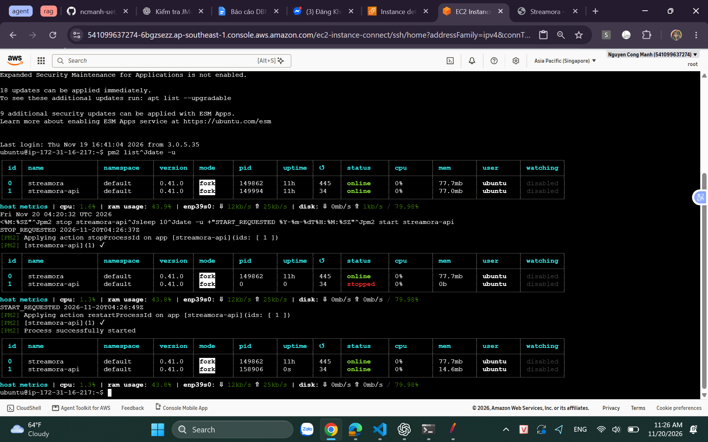
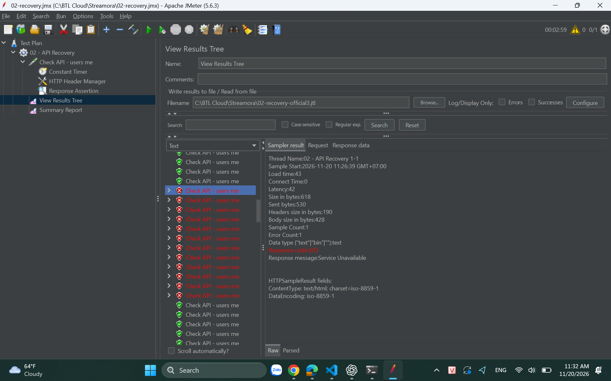
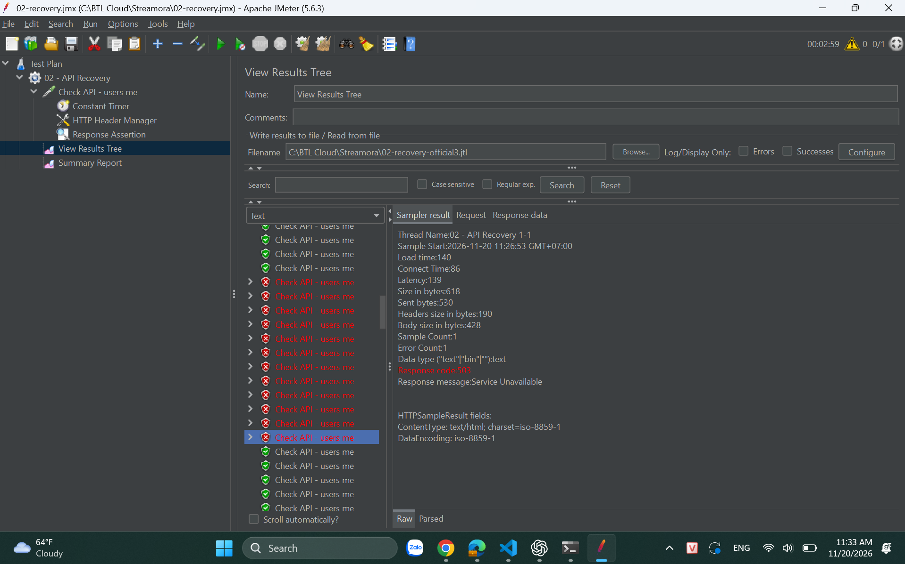
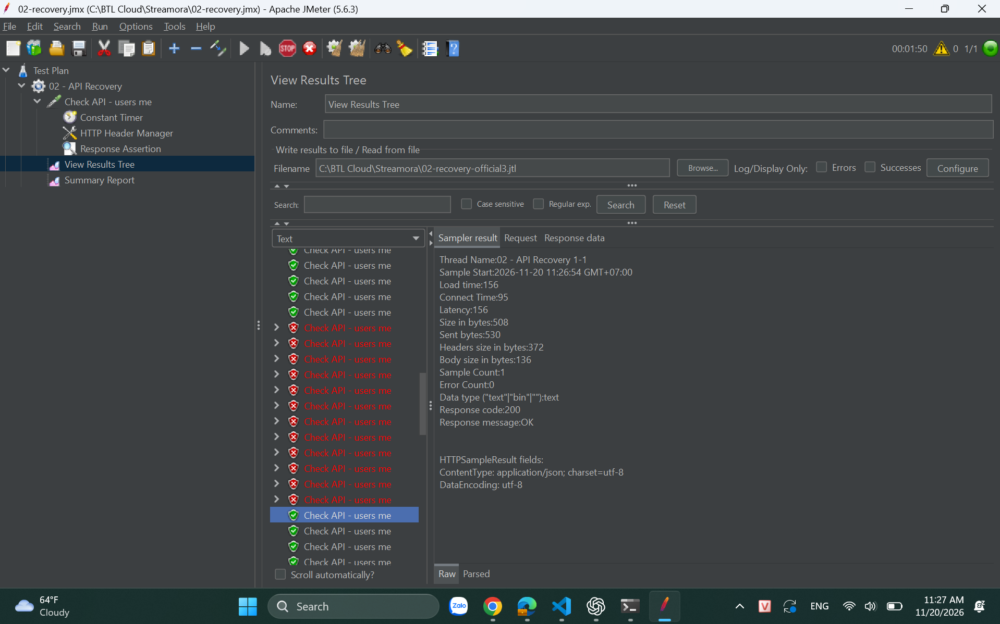
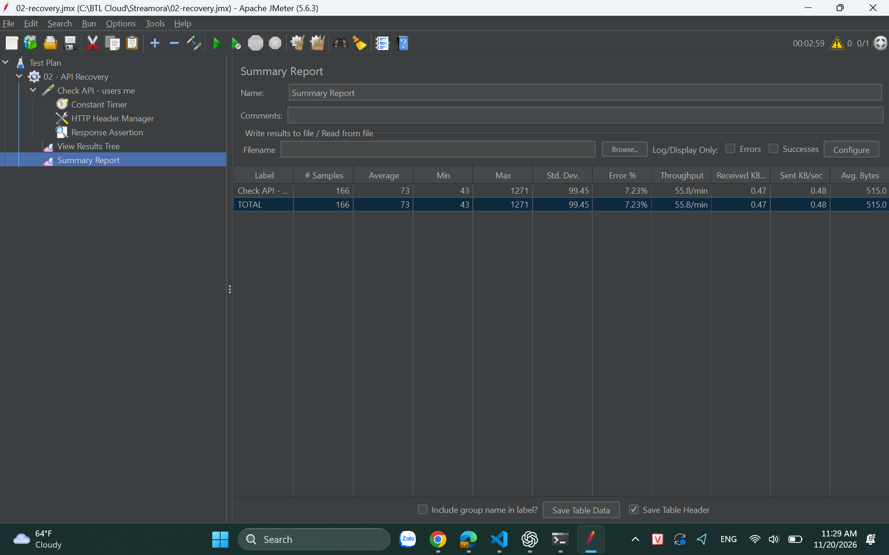

# Báo cáo Đánh giá và Kiểm thử Hiệu năng Hệ thống Streamora

> Kết quả kiểm thử bằng **Apache JMeter 5.6.3** cho môn **Điện toán đám mây**.  
> Phần bổ sung cho **Kịch bản 2 — Khả năng phục hồi sau sự cố (Recovery / RTO)**, theo cấu trúc báo cáo tổng hợp. Ngày thực hiện: **20/11/2026**.

---

## Kịch bản 2: Kiểm thử khả năng Phục hồi (Recovery / RTO)

### 2.1. Mục tiêu kiểm thử

Đánh giá khả năng đưa dịch vụ API Streamora trở lại trạng thái phục vụ sau khi chủ động ngắt tiến trình trên EC2:

1. Xác nhận request thành công trước sự cố, thất bại trong thời gian ngắt và thành công trở lại sau khi khởi động API.
2. Đo thời gian phục hồi quan sát được từ lúc yêu cầu dừng dịch vụ đến khi nhận được phản hồi HTTP 200 đầu tiên sau sự cố.
3. Ghi nhận số request thành công, số request lỗi và thời gian phản hồi trong toàn bộ lượt chạy.

**Phạm vi:** khởi động lại API **thủ công bằng PM2** trên cùng máy EC2. Lượt thử không mô phỏng mất toàn bộ EC2, mất vùng triển khai hoặc chuyển sang máy chủ dự phòng; chưa kiểm chứng khả năng tự phục hồi.

---

### 2.2. Môi trường & dữ liệu thử nghiệm

- **Máy khách:** Windows, chạy Apache JMeter 5.6.3 bằng giao diện đồ họa. Địa điểm địa lý của máy khách chưa được xác minh trong lượt thử này.
- **Máy chủ:** Ubuntu trên Amazon EC2, region **ap-southeast-1 (Singapore)**; tiến trình API do PM2 quản lý với tên `streamora-api`.
- **API kiểm thử:** `GET https://18-138-205-52.sslip.io/api/v1/users/me`.
- **Xác thực:** Bearer token hợp lệ của người dùng thử nghiệm. Không đưa token vào báo cáo.
- **Thời gian request đầu/cuối:** `11:25:52.415 → 11:28:50.775`, ngày **20/11/2026 (UTC+7)**; request cuối hoàn thành lúc `11:28:50.825`.
- **Kịch bản JMeter:** `02-recovery.jmx`.
- **Dữ liệu gốc:** [02-recovery-official3.jtl](data/02-recovery-official3.jtl).
- **Bảng tổng hợp xuất từ JMeter:** [02-recovery-summary.csv](data/02-recovery-summary.csv).

**Cấu hình JMeter:**

| Thành phần | Cấu hình |
| --- | --- |
| Thread Group | 1 người dùng, ramp-up 1 giây |
| Vòng lặp | Infinite, giới hạn thời lượng 180 giây |
| Khi request lỗi | Continue |
| HTTP Request | GET `/api/v1/users/me` |
| Connect / Response timeout | 3.000 ms / 3.000 ms |
| Constant Timer | Nghỉ 1.000 ms trước mỗi request |
| Response Assertion | Response Code Equals `200` |
| Listener | View Results Tree và Summary Report |

Khoảng cách giữa hai request còn bao gồm thời gian thực hiện request, nên cấu hình này không tương đương chính xác 1 request/giây.

---

### 2.3. Quy trình tạo sự cố và cách đo

1. Cho JMeter gọi API liên tục và xác nhận các request ban đầu trả HTTP 200.
2. Trong khi JMeter tiếp tục chạy, thực hiện lần lượt trên EC2:

```bash
date -u +"STOP_REQUESTED %Y-%m-%dT%H:%M:%SZ"
pm2 stop streamora-api
sleep 10
date -u +"START_REQUESTED %Y-%m-%dT%H:%M:%SZ"
pm2 start streamora-api
```

3. Quan sát các request thất bại trong thời gian ngắt và phản hồi HTTP 200 đầu tiên sau khi bật lại API.
4. Để JMeter kết thúc theo thời lượng đã cấu hình, xuất Summary Report và kiểm tra `pm2 list` sau lượt thử.

Lệnh `sleep 10` chạy sau khi lệnh dừng hoàn tất. Do đó, khoảng cách giữa hai mốc yêu cầu dừng/bật là **12 giây**, bao gồm thời gian thực hiện lệnh PM2 và thời gian chờ chủ động.

**Cách tính thời gian:**

```text
Thời điểm hoàn thành request = timeStamp + elapsed trong file JTL
Thời gian phục hồi từ lệnh dừng = thời điểm hoàn thành HTTP 200 đầu tiên sau lỗi − STOP_REQUESTED
Thời gian phục hồi từ lệnh bật = thời điểm hoàn thành HTTP 200 đầu tiên sau lỗi − START_REQUESTED
```

Mốc terminal dùng UTC; các mốc trong bảng dưới đã chuyển sang **UTC+7**. Đây là thời gian phục hồi thực đo trong lượt thử, không phải một cam kết RTO đã được xác lập cho hệ thống.

---

### 2.4. Kết quả đo lường

#### 2.4.1. Diễn biến sự cố

| Sự kiện | Thời gian ngày 20/11/2026 (UTC+7) | Kết quả / nguồn bằng chứng |
| --- | --- | --- |
| Request đầu tiên | 11:25:52.415 | HTTP 200, JTL |
| Yêu cầu dừng API | 11:26:37 | `STOP_REQUESTED`, terminal EC2 |
| Request lỗi đầu tiên | 11:26:39.507 | HTTP 503; hoàn thành sau 43 ms |
| Yêu cầu khởi động lại API | 11:26:49 | `START_REQUESTED`, terminal EC2 |
| Request lỗi cuối cùng | 11:26:53.438 | HTTP 503; hoàn thành sau 140 ms |
| Request thành công đầu tiên sau lỗi | 11:26:54.579 | HTTP 200; hoàn thành sau 156 ms, lúc 11:26:54.735 |
| Request cuối cùng | 11:28:50.775 | HTTP 200; hoàn thành sau 50 ms |

**Thời gian phục hồi quan sát được:**

- Từ mốc yêu cầu dừng: `11:26:54.735 − 11:26:37 ≈ 17,7 giây`, làm tròn **khoảng 18 giây**.
- Từ mốc yêu cầu bật lại: `11:26:54.735 − 11:26:49 ≈ 5,7 giây`, làm tròn **khoảng 6 giây**.

Hai kết quả là ước lượng: mốc terminal chỉ có độ phân giải một giây và phép tính đối chiếu đồng hồ máy khách với máy chủ, chưa đo độ lệch đồng hồ. Ngoài ra, JMeter thăm dò theo từng request nên không xác định được chính xác thời điểm API bắt đầu sẵn sàng giữa hai lần gọi.

#### 2.4.2. Thống kê toàn bộ lượt chạy

| Chỉ số | Kết quả |
| --- | ---: |
| Tổng số request | 166 |
| Request HTTP 200 | 154 |
| Request HTTP 503 | 12 |
| Tỷ lệ lỗi | 7,23% |
| Thời gian phản hồi trung bình, tính từ JTL | 73,72 ms |
| Thời gian phản hồi nhỏ nhất | 43 ms |
| Thời gian phản hồi lớn nhất | 1.271 ms |
| Throughput theo Summary Report | 55,8 request/phút, tương đương khoảng 0,93 request/giây |

Đối chiếu **toàn bộ JTL** cho thấy cả 12 request lỗi đều trả **503**, tập trung thành một chuỗi trong thời gian ngắt và khởi động API; không có lỗi xác thực 401 trong lượt đo này. Các lượt chạy thử và lượt bị lỗi token trước đó không được gộp vào số liệu.

Summary Report hiển thị Average là **73 ms**; phép tính từ 166 giá trị `elapsed` trong JTL cho kết quả **73,72 ms**. Trung bình này tính cả request thành công và thất bại, không dùng để đại diện riêng cho độ trễ khi dịch vụ hoạt động bình thường.

---

### 2.5. Hình ảnh minh chứng

Các ảnh dưới đây lấy trực tiếp từ ảnh chụp màn hình trong quá trình thực hiện lượt thử; được sao chép nguyên bản vào thư mục `images/`.

#### Hình 2.1 — Ngắt và khởi động lại API trên EC2



Terminal xác nhận hai mốc điều khiển và trạng thái tiến trình sau lệnh bật lại. Trạng thái PM2 `online` được đối chiếu thêm với HTTP 200 từ JMeter để xác nhận khả năng phục vụ API.

#### Hình 2.2 — Request HTTP 503 đầu tiên sau khi dừng API



Request bắt đầu chính xác lúc `11:26:39.507` theo JTL; giao diện ảnh hiển thị đến đơn vị giây.

#### Hình 2.3 — Request HTTP 503 cuối cùng trước khi phục hồi



#### Hình 2.4 — Request HTTP 200 đầu tiên sau sự cố



Request bắt đầu lúc `11:26:54.579` và hoàn thành lúc `11:26:54.735` theo JTL.

#### Hình 2.5 — Tổng hợp kết quả JMeter Summary Report



---

### 2.6. Nhận xét & Đánh giá kỹ thuật

1. **API phục vụ trở lại sau khi khởi động thủ công:** luồng kiểm thử ghi nhận HTTP 200 trước sự cố, HTTP 503 trong thời gian gián đoạn và HTTP 200 sau khi bật lại. Sau lượt thử, người thực hiện kiểm tra PM2 và ghi nhận `streamora-api` vẫn `online`, PID `158906`, uptime khoảng 7 phút.
2. **Thời gian phục hồi quan sát được khoảng 18 giây tính từ lệnh dừng**, bao gồm khoảng dừng chủ động và thời gian khởi động. Phần từ yêu cầu bật lại đến HTTP 200 đầu tiên khoảng 6 giây. Cần nêu rõ hai mốc để không quy toàn bộ 18 giây thành thời gian khởi động API.
3. **12 lỗi HTTP 503 là kết quả của tình huống chủ động gây gián đoạn.** Tỷ lệ lỗi 7,23% chỉ mô tả lượt thử 3 phút có sự cố này, không đại diện cho tỷ lệ lỗi thông thường hoặc độ sẵn sàng dài hạn của hệ thống.
4. **Giới hạn kiểm chứng:** một lần thử với một người dùng chưa đánh giá phục hồi khi tải cao, tự phát hiện sự cố, tự khởi động lại hoặc khôi phục sau mất EC2. Chưa có ngưỡng RTO mục tiêu trong tài liệu nên chưa kết luận đạt một SLA cụ thể. Có thể lặp lại cùng cấu hình ở các lượt sau để đánh giá độ ổn định của thời gian phục hồi.

**Kết luận:** Kịch bản 2 đã kiểm chứng được khả năng khôi phục phục vụ API bằng thao tác khởi động lại thủ công trên EC2, với thời gian phục hồi quan sát được khoảng **18 giây từ lệnh dừng** và **6 giây từ lệnh bật lại** trong điều kiện thử nghiệm đã nêu.
