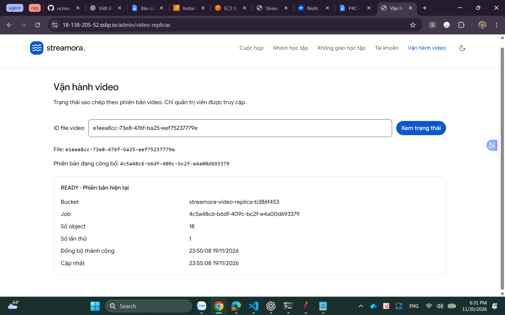
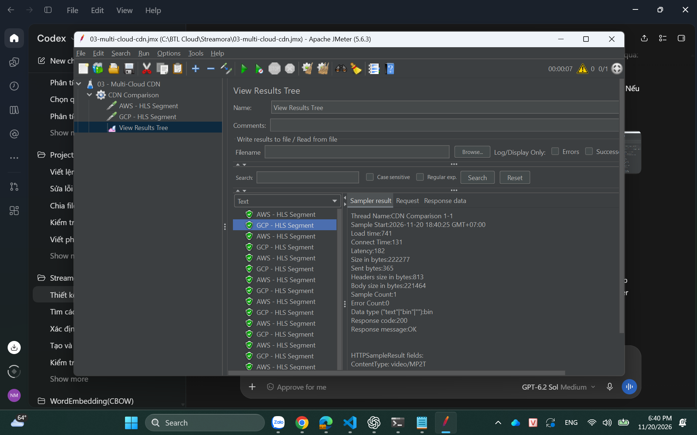

# Kịch bản 3 — Kiểm thử hiệu năng phân phối video qua AWS CloudFront và GCP Cloud CDN

Lượt đo từ **Hà Nội** ngày **20/11/2026** hoàn tất với **20/20 yêu cầu HTTP 200**. AWS CloudFront có Latency trung bình **64,9 ms**, còn GCP Cloud CDN có Latency trung bình **108,7 ms**. Nhóm cũng đã hoàn tất lượt đo qua điểm thoát VPN tại **New York** và tổng hợp kết quả ở mục 3.3.

## 3.1. Mục tiêu và cấu hình

So sánh thời gian nhận phản hồi đầu tiên, thời gian tải xong, trạng thái cache và điểm phục vụ (Edge POP) khi hai CDN phân phối cùng một segment HLS của Streamora.

- **Công cụ** — Apache JMeter 5.6.3 trên Windows, chạy chế độ dòng lệnh. Kịch bản dùng 1 người dùng, ramp-up 1 giây và 10 vòng lặp. Mỗi vòng gửi lần lượt một yêu cầu GET đến AWS và một yêu cầu GET đến GCP. [Tệp kịch bản JMeter](../../../03-multi-cloud-cdn.jmx)
- **Dữ liệu** — Segment `master_720p_00003.ts` của video `a - 2026-11-19T16-53-42-192Z.mp4`, có phần thân phản hồi **221.464 byte** trong các mẫu kiểm tra. Bản sao GCP của phiên bản đang công bố ở trạng thái `READY`.
- **Đích đo** — AWS CloudFront (`d1t5ktmqzfd56b.cloudfront.net`) và GCP Cloud CDN (`136-68-88-96.sslip.io`), với URL ký riêng cho cùng một segment.
- **Khoảng thời gian đo tại Hà Nội** — `18:42:48.086` đến `18:42:55.109` ngày 20/11/2026 (UTC+7), từ lúc gửi yêu cầu đầu tiên đến khi yêu cầu cuối cùng hoàn tất.
- **Cách đọc số liệu** — Chỉ số `Latency` của JMeter được dùng làm xấp xỉ TTFB. Chỉ số `Load time` đo đến khi nhận xong phản hồi. Trung bình và trung vị được tính trên 10 mẫu thành công của từng CDN. [Định nghĩa chỉ số JMeter](https://jmeter.apache.org/usermanual/glossary.html)

## 3.2. Kết quả tại Hà Nội

### AWS CloudFront

- **HTTP** — 10/10 phản hồi `200 OK`.
- **Latency** — Trung bình **64,9 ms**, trung vị **27 ms**, khoảng **17–380 ms**.
- **Thời gian tải trung bình** — **239,2 ms**.
- **Cache và Edge POP** — Cả 10/10 phản hồi báo `Hit from cloudfront` trong header `X-Cache`. Tất cả có `X-Amz-Cf-Pop: HAN51-P2` (Hà Nội).

### GCP Cloud CDN

- **HTTP** — 10/10 phản hồi `200 OK`.
- **Latency** — Trung bình **108,7 ms**, trung vị **52 ms**, khoảng **44–357 ms**.
- **Thời gian tải trung bình** — **459,3 ms**.
- **Cache và Edge POP** — Cả 10 phản hồi có `Age` dương, cho thấy được phục vụ từ cache. Logs Explorer trả về 10 mục khớp với segment trong khung giờ đo. Mục log được mở có `statusDetails: response_from_cache` và `cacheId: HKG` (Hong Kong). [Cách đọc log Cloud CDN](https://docs.cloud.google.com/cdn/docs/logging)

Trong lượt này, CloudFront có Latency trung bình thấp hơn **43,8 ms** và hoàn tất tải sớm hơn trung bình **220,1 ms**. Cả hai CDN đã có segment trong cache. Kết quả phản ánh 10 yêu cầu trên mỗi CDN cho một segment và một đường mạng tại thời điểm đo.

## 3.3. Kết quả tại New York (đo qua VPN)

Số liệu lượt đo New York do nhóm cung cấp.

### AWS CloudFront

- **HTTP** — 10/10 phản hồi `200 OK`.
- **Latency** — Trung bình **55,2 ms**, trung vị **23 ms**, khoảng **14–323 ms**.
- **Thời gian tải trung bình** — **203,3 ms**.
- **Cache và Edge POP** — Cả 10/10 phản hồi báo `Hit from cloudfront` trong header `X-Cache`. Edge POP thuộc khu vực New York (JFK).

### GCP Cloud CDN

- **HTTP** — 10/10 phản hồi `200 OK`.
- **Latency** — Trung bình **92,4 ms**, trung vị **44 ms**, khoảng **37–303 ms**.
- **Thời gian tải trung bình** — **390,4 ms**.
- **Cache và Edge POP** — Cả 10 phản hồi có `Age` dương, cho thấy được phục vụ từ cache. Các mục log tương ứng có `statusDetails: response_from_cache` và Edge POP thuộc khu vực New York. [Cách đọc log Cloud CDN](https://docs.cloud.google.com/cdn/docs/logging).

Trong lượt này, CloudFront có Latency trung bình thấp hơn **37,2 ms** và hoàn tất tải sớm hơn trung bình **187,1 ms**. Cả hai CDN đã có segment trong cache. Kết quả phản ánh 10 yêu cầu trên mỗi CDN cho một segment và một đường mạng, với hiệu năng cao hơn nhẹ so với kết quả tại Hà Nội.

## 3.4. Hình ảnh minh chứng

**Hình 3.1 —** Bản sao GCP của phiên bản đang công bố ở trạng thái `READY` với 18 object.



**Hình 3.2 —** Một mẫu GCP trả HTTP 200 trong lượt kiểm tra bằng giao diện JMeter. Kết quả tổng hợp ở mục 3.2 lấy từ lượt chạy dòng lệnh.



## 3.5. Chạy lại

Dùng file `streamora-cdn.properties` lưu bên ngoài repo. Đặt URL có chữ ký còn hạn của cùng một segment vào hai thuộc tính `aws_segment_url` và `gcp_segment_url`. Dùng JMeter 5.6.3 chạy lệnh dưới đây, thay đường dẫn file cấu hình và file đầu ra bằng đường dẫn trên máy đo.

```text
jmeter -n -t 03-multi-cloud-cdn.jmx -q /path/to/streamora-cdn.properties -l /path/to/03-cdn.jtl -Jjmeter.save.saveservice.output_format=xml -Jjmeter.save.saveservice.responseHeaders=true -Jjmeter.save.saveservice.url=false
```
